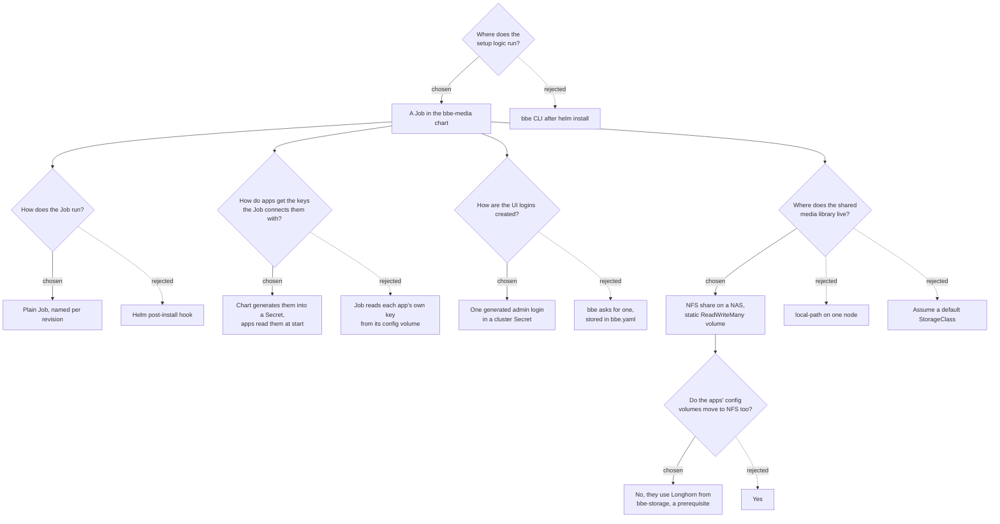

# 0001: Connecting the media apps on install

**Status:** accepted, 2026-09-24

## Context

`bbe-media` installs Sonarr, Radarr, Prowlarr, Bazarr, Jellyfin and Seerr (formerly Jellyseerr), and now qBittorrent. Until now every app started unconfigured. Each one asked for its own login on the first visit and generated its own API key, and the user then had to copy keys between six web UIs to connect them. Two things made that worse:

- qBittorrent 4.6.1 and later print a new temporary password on every start until one is set, so there was no stable login to give Sonarr and Radarr.
- Each chart created its own media volume, so a file qBittorrent downloaded couldn't be seen by Sonarr, and one Sonarr imported couldn't be seen by Jellyfin.

The goal: after `bbe install`, every app is connected, and the user is left with only what bbe can't know: which indexers to use.

## Decision tree



## Decisions

### 1. The setup runs as a Job inside the chart

A Job in `bbe-media` waits for the apps, then configures them through their HTTP APIs. It runs inside the cluster, so it reaches every app by its service name and reads the Secrets directly. It also works for anyone installing with plain `helm install`.

Rejected: doing it from the bbe CLI after `helm install`. The CLI would need to reach every pod from the user's machine through port-forwards, the logic would live in a different repository from the charts it depends on, and it would only work through bbe.

### 2. The Job is a plain Job named after the release revision

`bbe-media-setup-<revision>` is a normal resource of the release. A new revision gets a new Job, so every upgrade sets the apps up again, and Helm removes the previous one.

Rejected: a `post-install,post-upgrade` hook. Helm waits for hooks to finish and fails the whole install after `--timeout`, 5 minutes by default. A first install pulls seven images and waits for Jellyfin's first start, which can take longer than that on a small node. As a plain Job, it retries on its own (`bbe.setup.backoffLimit`) while `helm install` returns straight away.

### 3. API keys are generated by the chart and handed to the apps at start

`templates/secrets.yaml` generates a key per app into `bbe-media-api-keys`, and reads the existing ones back with `lookup` on upgrades, so a key never changes after the first install. Each app is then started with its key:

| App | How it reads the key |
|---|---|
| Sonarr, Radarr, Prowlarr | `<APP>__AUTH__APIKEY`: these apps bind their `Auth` settings from environment variables (`Bootstrap.cs`) |
| Bazarr | `DYNACONF_AUTH__APIKEY`: Bazarr loads its settings with Dynaconf 3.2, which reads `DYNACONF_` overrides |

The Job gets the same keys from the same Secret, so it never has to discover them.

Rejected: letting each app generate its key and having the Job read it from the app's config volume. Those volumes are `ReadWriteOnce`, so the Job would have to run on the same node as every app, and it would have to parse four config formats.

The app charts' env schemas now allow `valueFrom`, which is what lets `bbe-media` pass keys as `secretKeyRef`s rather than as plain text in its values.

### 4. One generated admin login for every UI

`bbe-media-admin` holds a username (`bbe.admin.username`, default `admin`) and a 24-character password generated on the first install and kept on upgrades. The Job sets it as the login of Sonarr, Radarr, Prowlarr and Bazarr, and creates it as Jellyfin's first administrator. Seerr's admin is the same account, as it signs in through Jellyfin. qBittorrent's chart writes it into `qBittorrent.conf` before qBittorrent starts (`qbittorrent.webui.existingSecret`), hashed with PBKDF2-SHA512 like qBittorrent itself.

The chart's notes print the command to read the password. Nothing secret ends up in `bbe.yaml`, which bbe syncs to S3 when AWS storage is on.

Rejected: having bbe ask for the login and store it in `bbe.yaml`. It would be plain text in a file that leaves the machine.

### 5. The media library is an NFS share

The user gives an NFS server and path (`bbe.media.nfs`). They're required values, so bbe asks for them. The chart creates a static `ReadWriteMany` volume for that share and one claim, `bbe-media-library`, and every app mounts it at `/media`:

```
/media/downloads   qBittorrent saves here
/media/tv          Sonarr's root folder, Jellyfin's Shows library
/media/movies      Radarr's root folder, Jellyfin's Movies library
```

The same path in every app means Sonarr and Radarr move finished downloads instead of copying them, and no app needs a path mapping. The volume's reclaim policy is `Retain`, and deleting a static NFS volume never touches the share's data.

Rejected: local-path on one node, which ties every media app and the library to that node's disk. Assuming a default StorageClass was also rejected: bbe clusters don't have one, and a `ReadWriteOnce` volume would still need every app on one node.

Talos mounts NFS through its kubelet image. NFSv3 needs `nolock` there, as Talos runs no lock daemon, so the default is `nfsvers=4`, which locks within the protocol. It uses the newest NFSv4 version the server offers: 4.1 where available, 4.0 on a Synology NAS that doesn't offer 4.1. Pinning `nfsvers=4.1` failed against one with `mount.nfs: Protocol not supported`.

### 6. Config volumes stay off NFS

Every app keeps a SQLite database in its config volume, and SQLite over NFS is a known cause of corruption. The Servarr apps warn against it outright. Config volumes use the cluster's default StorageClass instead.

bbe clusters have no StorageClass of their own, so `bbe-media` declares one as a prerequisite in its `Chart.yaml`: the `longhorn` storage class, provided by the `bbe-storage` package. When it's missing, bbe offers to install `bbe-storage` before `bbe-media`, and to set up the nodes Longhorn needs.

### 7. The node holds 31Gi, only what's faster there

Long-term storage is the NAS. Longhorn keeps its data on the node's system disk, so `bbe-media` only puts there what is faster on a local disk, 31Gi together:

| Volume | Size | Why on the node |
|---|---|---|
| Sonarr, Radarr, Prowlarr, Bazarr, qBittorrent configs | 1Gi each | SQLite databases (decision 6) |
| Jellyfin config | 3Gi | Its database, plus metadata and images, which grow with the library |
| Jellyfin transcoding | 2Gi | Transcoding writes here as it streams, at `/transcode`, which the Job sets as Jellyfin's transcoding path. Without it, transcodes would share the config volume with Jellyfin's database |
| Seerr config | 1Gi | Its database |
| qBittorrent downloads in progress | 20Gi | Torrents write in small random pieces, which a NAS handles slowly. qBittorrent moves each download to `/media/downloads` on the NAS once it completes |

Downloads in progress share the 20Gi, so a torrent that doesn't fit waits for others to complete, and one larger than 20Gi can't complete at all. Raise `qbittorrent.incomplete.size` for large downloads; Longhorn can grow the volume in place. Rejected: keeping downloads in progress on the NAS, which works but is slower, and is what turning `qbittorrent.incomplete.enabled` off does.

### 8. The apps write the library as a dedicated NAS user

Nothing writes to the NAS as root, so the share can map root away and a client allowed to mount it never gets root on it. A NAS user owns the share, and `bbe.media.user.uid` and `gid` (required, bbe asks for them) are its IDs:

- **Sonarr, Radarr, qBittorrent (linuxserver) and Bazarr (hotio)** start as root, then drop to the user in `PUID` and `PGID`, which they read from the `bbe-media-user` config map. The app charts used to always add their own `PUID` and `PGID` after the values, and as the last of two variables with one name wins, that overrode them with root. The charts' defaults now only fill in what the values leave out.
- **Jellyfin runs the linuxserver image** instead of the official one, which can only change user through the pod's `securityContext`. A parent chart can't fill that in from its own values, so the IDs would have to be entered twice. The linuxserver image keeps its data in `/config/data` and its cache in `/config/cache`, and transcodes in `/transcode`.
- **The Job runs as the user**, as it creates the library's folders.
- **qBittorrent's downloads in progress** are handed to the user by an init container, as a new volume belongs to root.
- Prowlarr and Seerr never touch the library and keep their defaults.

Rejected: mapping all users to the share's owner on the NAS, which Synology only offers for `admin`, and running the apps as root with `no_root_squash`, which gives root on the share to every client allowed to mount it.

#### Setting up the share on a Synology NAS

1. **Create the user:** Control Panel → User & Group → Create, named for example `bbe-media`, with a long random password. Keep it out of `administrators`, and deny it every application.
2. **Create the share:** Control Panel → Shared Folder → Create, for example `bbe-media`. Give the user Read/Write and nobody else access.
3. **Find the IDs:** run `id bbe-media` over SSH, or as a one-off Task Scheduler script writing to a file. It prints something like `uid=1031(bbe-media) gid=100(users)`.
4. **Allow the nodes:** edit the share → NFS Permissions → Create, with the nodes' IPs or their range as Hostname or IP, Read/Write, **Map root to guest**, security `sys`, and "Allow users to access mounted subfolders" ticked.
5. **Enable NFSv4:** Control Panel → File Services → NFS → Maximum NFS protocol: NFSv4, or NFSv4.1 where DSM offers it.

### 9. Indexers are part of the install, added with `bbe configure`

Indexers are listed in `bbe.media.prowlarr.indexers`, so a reinstall or a new cluster gets them back like every other setting. `bbe configure bbe-media` adds and removes them: it searches the definitions Prowlarr ships for one, asks for its fields, keeps credentials in the `bbe-media-indexers` secret instead of `bbe.yaml`, and upgrades the release. The chart declares that list in its `bbe/settings` annotation, so bbe needs no knowledge of Prowlarr beyond reading its catalog.

The Job adds and updates the listed indexers, tagged `bbe`, and removes `bbe`-tagged ones that are no longer listed. Indexers added in Prowlarr itself are left alone. Prowlarr searches an indexer before saving it, which can take up to 100 seconds, and refuses one it can't reach. So each indexer is saved on its own: one failing is reported, the others are still saved, and the Job tries the failed one again.

Rejected: shipping a list of indexers to enable by default, which would have bbe decide which sites a cluster searches.

### 10. FlareSolverr gets the indexers Cloudflare blocks past it

Many indexers sit behind Cloudflare, and Prowlarr refuses to save one whose challenge it can't pass, with "blocked by CloudFlare Protection". `bbe-media` runs FlareSolverr (`bbe.media.flaresolverr`), and the Job adds it to Prowlarr as an indexer proxy tagged `flaresolverr`, as [TRaSH's guide](https://trash-guides.info/Prowlarr/prowlarr-setup-flaresolverr/) sets it up. Prowlarr only sends an indexer through a proxy that shares its tag, and only when it meets Cloudflare.

Following the guide, only the indexers that need it get the tag: when Prowlarr refuses an indexer because of Cloudflare, the Job tags it `flaresolverr` and saves it again. The tag stays on later runs, so nobody has to know in advance which indexers need it.

FlareSolverr runs Chromium as a non-root user, inside the cluster only, with up to 1Gi of memory. It doesn't get past every challenge, and an indexer it can't get past still fails on its own.

## What the Job sets up

Every step reads the current state first, so a second run only updates bbe's own connections and adds nothing twice. The connections are found again by name: `qBittorrent` in Sonarr and Radarr, `Sonarr` and `Radarr` in Prowlarr.

| App | Set up |
|---|---|
| qBittorrent | Keeps downloads in progress in `/incomplete` on the node, then saves them to `/media/downloads` |
| Sonarr, Radarr | Admin login, root folder, qBittorrent as download client |
| Prowlarr | Admin login, Sonarr and Radarr as applications with full sync, FlareSolverr as an indexer proxy, the indexers in `bbe.media.prowlarr.indexers`, tagged for FlareSolverr when Cloudflare blocks them |
| Bazarr | Admin login, connected to Sonarr and Radarr |
| Jellyfin | Startup wizard with the admin account, Shows and Movies libraries, transcoding in `/transcode` |
| Seerr | Signed in through Jellyfin, libraries enabled, Sonarr and Radarr connected with the HD-1080p profile when it exists |

Left to the user: adding indexers in Prowlarr. They depend on which sites someone uses, and Prowlarr pushes them to Sonarr and Radarr from there.

## Consequences

- **The NFS export must let the NAS user write**, which owns the share (decision 8). Root can be mapped away.
- **Uninstalling deletes the `bbe-media` namespace** with everything in it: the apps' settings and databases, their logins and API keys, and the indexers' credentials. The media on the NFS share stays, as the volume only links to it. bbe asks to confirm first.
- **Seerr replaces Jellyseerr**, which it became, at release 3.5.0 on the `seerr-chart` chart. An upgraded install gets a new Seerr, which the Job signs in and connects again. Jellyseerr's requests stay on its old volume.
- **Jellyfin's data moves.** Earlier `bbe-media` versions ran the official Jellyfin image, which keeps its data directly in `/config`. The linuxserver image starts with an empty `/config/data`, so an upgraded install starts Jellyfin over; the old data stays on its volume.
- **Changing the NFS server or path after installing fails the upgrade**, as a volume's source can't be changed. Uninstall and install again instead. The media stays on the share.
- **Changing `bbe.admin.username` after installing** updates every app except Jellyfin and Seerr, whose accounts are created once.
- **Older bbe versions can't install this chart version**, as they can't ask for the required NFS values. `required-versions.yaml` has to raise `bbe-media`'s `min-bbe-cli` to the first bbe release that can.
- **Verified against real apps:** Sonarr 4.0.20, Radarr 6.4.4, Prowlarr 2.6.5, qBittorrent 5.2.3 and Jellyfin 10.11.11 ran natively, with the Job's script run twice against them. Bazarr 1.6.1 and Jellyseerr 2.7.3 couldn't be started there. Their steps follow their source and were run against stubs, so the first real install is their first real test.
