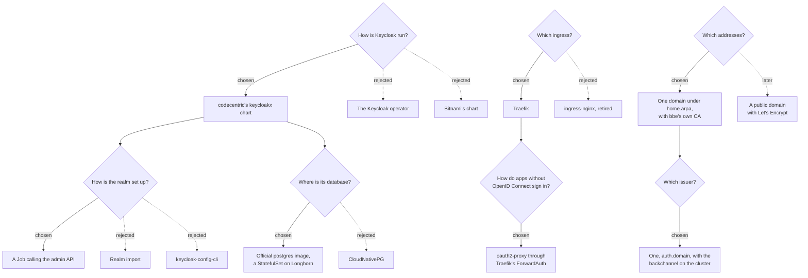

# 0002: Single sign-on with Keycloak

**Status:** proposed, 2026-10-14

## Context

Every bbe-media app has its own login, all set to the one generated admin account ([0001](0001-media-auto-setup.md), decision 4). That's one person with one password. Letting someone else in means sharing that password, and taking it back means changing it in every app.

The goal: people are managed in one place, Keycloak, through its console or `bbe configure`, and the apps are reached at HTTPS addresses that ask for a Keycloak sign-in.

Three things shaped what follows:

- **ingress-nginx was retired in March 2026.** It gets no more releases or security fixes, and single sign-on hangs off the ingress controller.
- **The apps had no addresses.** Nothing in the cluster had a name or a certificate yet.
- **Most of the apps can't sign anyone in with OpenID Connect.** Sonarr, Radarr, Prowlarr, Bazarr and qBittorrent only have their own logins. Jellyfin needs a plugin, and Seerr 3.5.0 has no OpenID Connect at all (decision 8).

## Decision tree

## Decisions

### 1. Keycloak runs from codecentric's keycloakx chart

`bbe-auth` depends on [keycloakx](https://github.com/codecentric/helm-charts/tree/master/charts/keycloakx) 7.3.2, a StatefulSet over the official `quay.io/keycloak/keycloak` image, which it pins to 26.7.5 itself. The chart trails Keycloak's releases by weeks: a critical CVE fix took 8 days to reach it (keycloakx#920).

Its defaults need three changes:
- `http.relativePath` is `/` instead of `/auth`.
- `proxy.mode` is `xforwarded`, as Traefik sends `X-Forwarded-*` headers.
- Keycloak is started with `start`, which the chart leaves to its values.

Rejected:
- **The Keycloak operator.**
  - Its CRDs, ClusterRoles and ClusterRoleBinding are cluster-wide, so it doesn't fit in one namespaced package.
  - Its Helm chart is new in 26.8.0 and experimental. It watches every namespace by default and deletes its CRDs, with every Keycloak in them, on `helm uninstall`.
  - One operator version supports one Keycloak version.
  - Its `KeycloakRealmImport` only creates realms and never updates them, and its client CRDs are a preview.
  - It asks for 1.7–2Gi of memory by default.
- **Bitnami's chart.** Bitnami's charts and images changed licensing and moved to `bitnamilegacy` in 2025.

### 2. A Job sets Keycloak up through its admin API

Like bbe-media's setup (0001, decisions 1 and 2), `bbe-auth-setup-<revision>` runs after every install and upgrade. It reads before it writes, so a second run changes nothing. It signs in as a service account that Keycloak creates in its master realm on its first start (`KC_BOOTSTRAP_ADMIN_CLIENT_*`), and sets up:

| What | How |
|---|---|
| The `bbe` realm | Created once. Registration and password resets are off, as people are added by an admin and there's no mail server. Brute force protection is on. Its settings are left to the console after that |
| `admins` and `users` | Groups. `admins` gets the realm's `realm-admin` role, so admins manage people in the console |
| A `groups` claim | A client scope putting a user's group names in their tokens and user info |
| Clients | `oauth2-proxy`, with an audience mapper, as oauth2-proxy checks a token was made for it. Plus any app in `bbe.auth.clients` that signs people in itself, none yet. Their secrets are generated into `bbe-auth-clients` |
| Users | The first admin, then the users in `bbe.auth.users` (decision 9) |

Rejected:
- **Realm import.** It's skipped when the realm exists, so nothing changes after the first install.
- **keycloak-config-cli.** It's tested up to Keycloak 26.5.5. It also deletes whatever of a type isn't in its config, which would fight with people managed in the console.

### 3. PostgreSQL runs from the official image

Keycloak's database is a StatefulSet with `postgres:18.6`, on a 2Gi volume of the default storage class. `bbe-auth` needs Longhorn from `bbe-storage`, as bbe-media does (0001, decision 6). It runs as the image's `postgres` user (999), with a read-only root filesystem and no capabilities, which the `restricted` pod security level allows. PostgreSQL 18 keeps its data in `/var/lib/postgresql/18/docker`, so the volume is mounted at `/var/lib/postgresql`.

Rejected: **CloudNativePG**, which would handle backups and upgrades. Its operator is cluster-wide with its own CRDs and webhooks, so it would be a package of its own, for one small database on one node.

### 4. Traefik replaces ingress-nginx

`bbe-networking` runs Traefik 3.7 (chart 41.7.1) on the ingress's IP. Apps behind oauth2-proxy use its `ForwardAuth` middleware.

Traefik ships its CRDs in its chart's `crds/` folder, which Helm only installs on a first install. bbe applies them before every install and upgrade (bbe-quest#54).

Rejected: **ingress-nginx**, which was retired in March 2026. bbe-networking also allowed its snippet annotations at risk level `Critical`, with which any Ingress could get around the login.

### 5. The apps are named under one domain, with bbe's own certificate authority

Apps are reached at `<app>.bbe.home.arpa` (`global.bbe.domain`):
- Blocky answers for the domain and everything under it with the ingress's IP.
- cert-manager creates bbe's own certificate authority (`bbe-ca`) and a certificate for the domain and `*.` under it. Traefik serves that for every app, so an Ingress only lists its host under `tls`.

The domain sits below `home.arpa` (RFC 8375) because `home.arpa` is on the Public Suffix List. Browsers refuse a `*.home.arpa` certificate, and won't share a cookie across it, which oauth2-proxy's one sign-in for every app relies on.

Devices only trust the apps once they trust bbe's CA, which the notes explain how to save. Phones, TVs and their apps are where that's hardest.

Left for later: **a public domain with Let's Encrypt**, through a DNS-01 challenge. It would make every device trust the certificate. There's no domain to test it with yet, and it fits in as a second certificate in Traefik's TLS store.

### 6. Keycloak has one issuer, and apps reach it over the cluster

Keycloak is named `https://auth.<domain>` (`KC_HOSTNAME`), with `KC_HOSTNAME_BACKCHANNEL_DYNAMIC`. In Keycloak 26.7.5, run with PostgreSQL in Docker:
- The issuer and the sign-in page always use the public address.
- The token and key endpoints follow the address they're asked on.
- Tokens fetched through the internal address still carry the public issuer.

So oauth2-proxy signs people in at `https://auth.<domain>`, but fetches tokens and keys from `http://bbe-auth-keycloak-http.bbe-auth.svc`. Pods never resolve `*.bbe.home.arpa` or trust bbe's CA, as nodes don't ask Blocky.

Rejected: letting the issuer follow the request's address. A login through one address then makes tokens another client rejects, and a refresh through the other address fails.

### 7. oauth2-proxy lets admins into the apps without OpenID Connect

One oauth2-proxy runs in `bbe-auth`, with oauth2-proxy itself served at `auth.<domain>/oauth2`:
- Its cookie is for `.<domain>`, so one sign-in covers every app.
- An app's Ingress uses a Traefik `ForwardAuth` middleware in its own namespace, pointing at oauth2-proxy's service. oauth2-proxy answers 202 (`static://202`) when someone is signed in, and sends them to Keycloak otherwise.
- Only `admins` get through. These apps manage the media and the downloads, rather than play anything.

Behind it, each app stops asking for its own login. Its own login and API key stay for bbe-media's setup Job, and for the apps talking to each other:

| App | How it trusts the proxy |
|---|---|
| Sonarr, Radarr, Prowlarr | `AuthenticationMethod` `External`. Their API keys still work |
| Bazarr | `auth.type` `None`. Its API key still works |
| qBittorrent | An oauth2-proxy sidecar in front of it. qBittorrent only skips its login for `127.0.0.1`, which is the sidecar. Sonarr, Radarr and the setup Job use its API key (qBittorrent 5.2) |

Rejected for qBittorrent: skipping its login for the cluster's own addresses. Traffic through the ingress arrives from Traefik's pod, which is one of those addresses, so every browser would skip it too. Talos' flannel doesn't enforce NetworkPolicy, so the port can't be fenced off either.

The same gap applies to the Servarr apps on `External`: their pods can be reached directly from inside the cluster, where `/initialize.json` hands out the API key. Only traffic through the ingress is protected.

### 8. Jellyfin and Seerr keep their own logins

They're reached at `<app>.<domain>` like the other apps, but not behind oauth2-proxy, and not signed in through Keycloak:

- **Jellyfin.**
  - Its SSO-Auth plugin was archived in May 2026.
  - On Jellyfin 10.11 it creates users without a password, so anyone knowing a name signs in with an empty one. The fork's fix needs Jellyfin 12.
  - Jellyfin's TV and phone apps can't sign in through a browser either, only with Quick Connect.
  - And oauth2-proxy in front of Jellyfin would lock those apps out.
- **Seerr.**
  - 3.5.0 has no OpenID Connect; its support is planned for 3.6.0 (seerr#2715).
  - It signs people in through Jellyfin. With Jellyfin on its own logins, that stays as it is.

When Seerr 3.6.0 ships, it can become a client in `bbe.auth.clients`.

### 9. People are managed in Keycloak's console and with `bbe configure`

On install, bbe asks for the first admin's username and email (`bbe.auth.admin`). Their first password is generated into `bbe-auth-admin`, and they choose a new one when they first sign in. Admins then manage people in the console at `auth.<domain>/admin/bbe/console/`.

`bbe configure bbe-auth` adds and removes users too:
- The chart's `bbe/settings` lists a user's fields: username, email, first and last name, group, and a first password bbe generates and shows once (bbe-quest#55).
- The password goes to the `bbe-auth-users` secret, not `bbe.yaml`.

The Job creates each listed user with that password, marked temporary, and an attribute `bbe: managed`. For those users only, it keeps `admins` and `users` as the values say, and deletes the ones no longer listed. Like indexers (0001, decision 9), people added in the console are left alone. A listed name that already belongs to someone the console added is skipped, with a warning.

### 10. Two ways in when Keycloak can't help

- **bbe-media's generated admin login stays.** It's still what the setup Job signs in with, and it's the way into Jellyfin and Seerr, which keep their own logins.
- **Keycloak's own admin**, `bbe-admin` in the master realm, is created on Keycloak's first start, with its password in `bbe-auth-keycloak`. It's for when nobody in the `bbe` realm can sign in. Keycloak marks it as a temporary admin in its console.

## Consequences

- **Devices have to trust bbe's CA**, or they warn about every app. Until there's a public domain with Let's Encrypt, that includes phones and TVs.
- **Everyone needs the domain to resolve**, so devices have to use Blocky for DNS, which is easiest to set in the router's DHCP.
- **`users` gets no app yet.** oauth2-proxy only lets `admins` through, and Jellyfin and Seerr have their own logins. The group is there for apps that let everyone signed in through.
- **Removing someone from the list in `bbe.yaml` deletes them in Keycloak**, if bbe created them. Changing the group of a user bbe created in the console is undone by the next upgrade. Their name and email are only set when they're created.
- **Uninstalling `bbe-auth` deletes everyone**, with the namespace and Keycloak's database.
- **A new PostgreSQL major version needs a dump and restore.** Changing `bbe.postgres.image.tag` to one doesn't migrate the data.
- **Keycloak takes up to 1Gi of memory**, which its JVM sizes its heap from, and up to a minute to start.
- **bbe-networking needs helm 3.10 and bbe 1.6.1, and bbe-auth bbe 1.7.0.**
  - Traefik's templates use `break`, which helm 3.9 can't parse.
  - bbe 1.6.1 applies a chart's CRDs before installing or upgrading it.
  - bbe 1.7.0 reads settings that list fields, and prerequisites that only name a package.
- **What's verified, and what isn't:**
  - bbe-networking ran on `present-sprite`: Traefik, the certificates, Blocky's answers, and HTTPS against bbe's CA.
  - Keycloak 26.7.5 and PostgreSQL 18.6 ran in Docker. The setup script ran against them, and a second run changed nothing. They also showed group changes, removals, a user the console added being left alone, the issuer staying public while tokens came through the service, and PostgreSQL running as 999 on a read-only root.
  - Nothing of `bbe-auth` has run on a cluster yet, as the test cluster was torn down. Not tested end to end:
    - the chart as a whole;
    - oauth2-proxy behind Traefik's ForwardAuth;
    - signing in from a browser;
    - `bbe configure bbe-auth` against a real install.
