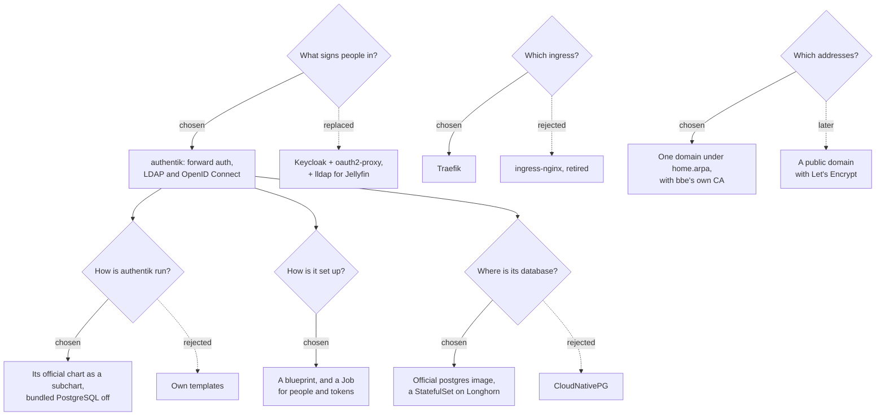

# 0002: Single sign-on with authentik

**Status:** proposed, 2026-10-15

## Context

Every bbe-media app has its own login, all set to the one generated admin account ([0001](0001-media-auto-setup.md), decision 4). That's one person with one password. Letting someone else in means sharing that password, and taking it back means changing it in every app.

The goal is one place to manage people, with one password each for every app, Jellyfin's TV and phone apps included. People are managed in authentik's admin interface or with `bbe configure`, and the apps are reached at HTTPS addresses.

Four things shaped what follows:

- **ingress-nginx was retired in March 2026.** It gets no more releases or security fixes, and single sign-on hangs off the ingress controller.
- **The apps had no addresses.** Nothing in the cluster had a name or a certificate yet.
- **Most of the apps can't sign anyone in themselves.** Sonarr, Radarr, Prowlarr, Bazarr and qBittorrent only have their own logins.
- **Jellyfin's apps only sign in with a username and password.** Its TV and phone apps can't sign in through a browser, and the SSO-Auth plugin was archived in May 2026. Jellyfin's official LDAP plugin works everywhere.

The first version of this used Keycloak and oauth2-proxy (decision 1). It moved to authentik before any release, so that one product covers forward auth for the apps and LDAP for Jellyfin.

## Decision tree

## Decisions

### 1. authentik signs people in

[authentik](https://goauthentik.io) 2026.8.4 covers everything bbe needs in one product:
- **Forward auth for the apps that can't sign people in.** Traefik asks it about every request.
- **LDAP for Jellyfin**, through its LDAP outpost.
- **OpenID Connect** for apps added later.

It needs PostgreSQL only, as it dropped Redis in 2025.10.

Rejected: **Keycloak with oauth2-proxy**, which this was first built with. Keycloak can't serve LDAP, so Jellyfin would have needed lldap as well. That's three products to run for what authentik does alone, with people managed in lldap rather than in one place.

### 2. authentik runs from its official chart

`bbe-auth` depends on [goauthentik/helm](https://github.com/goauthentik/helm) `authentik` 2026.8.4, with:
- `fullnameOverride: bbe-auth`, so its services are `bbe-auth-server` and `bbe-auth-worker`.
- Its bundled PostgreSQL off: bbe-auth runs its own (decision 4). The chart still lists Bitnami's PostgreSQL chart as a dependency, which is only downloaded when packaging, never installed.
- `serviceAccount.create: false`, and no ServiceAccount token on the worker. authentik doesn't deploy outposts itself (`AUTHENTIK_OUTPOSTS__DISCOVER=false`), so it needs no access to the Kubernetes API.
- bbe-auth's own secret, `bbe-auth-authentik`, through `global.envFrom`. It comes after the chart's own secret, so it wins. It holds:
  - the secret key, which never changes after the first install;
  - the database password;
  - the bootstrap admin and token;
  - `AUTHENTIK_WEB__BASE_URL`;
  - the values the blueprint reads.
- Non-root, no capabilities and the `RuntimeDefault` seccomp profile on its pods, which the `restricted` pod security level allows.

Rejected: **writing the server and worker Deployments ourselves.** The chart is maintained by authentik, and only two Deployments to configure.

### 3. A blueprint sets authentik up, and a Job the rest

authentik applies blueprints, YAML files describing what to create, on start and whenever they change. bbe's, `files/blueprints/bbe.yaml`, is mounted on the worker from a ConfigMap. It reads the domain and the LDAP account's password from the environment (`!Env`), and holds:

| What | How |
|---|---|
| `admins` and `users` | Groups. `admins` get into every app, `users` into Jellyfin, and Seerr through it |
| Forward auth | A proxy provider in `forward_domain` mode for `.<domain>`, on authentik's embedded outpost, and an application only `admins` may use |
| LDAP | A provider with `direct` bind and search, and without a code after the password (`mfa_support: false`). An application for `users`, `admins` and the accounts Jellyfin and the book library bind with, and an outpost bbe-auth runs (decision 7) |
| The LDAP accounts | `jellyfin-ldap` and `books-ldap`, service accounts whose app passwords are generated into `bbe-auth-authentik`, allowed to search the whole directory |
| Shelfmark | An OAuth2 provider for the book library's search, which `users` and `admins` may use ([0004](0004-book-library.md)) |
| bbe's looks | Decision 10 |

The setup Job, `bbe-auth-setup-<revision>`, does what a blueprint can't:
- **Applies the blueprint now.** The worker only queues an apply, so the Job waits until authentik reports the exact version the chart ships (its sha512) as applied, as it does for authentik's own default flows.
- **Gives the LDAP outpost its token.** The outpost's token is created with it, so the Job sets it to the one in `bbe-auth-authentik`, which the outpost's Deployment signs in with.
- **Keeps the people bbe manages in line** (decision 9).

The Job signs in with authentik's bootstrap token, which belongs to `akadmin`. It reads before it writes, so a second run changes nothing.

### 4. PostgreSQL runs from the official image

authentik's database is a StatefulSet with `postgres:18.6`, on a 2Gi volume of the default storage class. `bbe-auth` needs Longhorn from `bbe-storage`, as bbe-media does (0001, decision 6). It runs as the image's `postgres` user (999), with a read-only root filesystem and no capabilities. PostgreSQL 18 keeps its data in `/var/lib/postgresql/18/docker`, so the volume is mounted at `/var/lib/postgresql`.

Rejected: **CloudNativePG**, which would handle backups and upgrades. Its operator is cluster-wide with its own CRDs and webhooks, so it would be a package of its own, for one small database on one node.

### 5. Traefik replaces ingress-nginx

`bbe-networking` runs Traefik 3.7 (chart 41.7.1) on the ingress's IP. The apps behind authentik use its `ForwardAuth` middleware.

Traefik ships its CRDs in its chart's `crds/` folder, which Helm only installs on a first install. bbe applies them before every install and upgrade (bbe-quest#55).

MetalLB's and cert-manager's CRDs are in `bbe-networking`'s own `crds/` folder too, with their charts' CRD templates off. On a first install, Helm 3.22 couldn't map the address pools and certificates its hooks create to kinds the same install had just created from templates: it only refreshes the kinds it knows after installing `crds/`. `update-crds.sh` writes them from the chart versions `Chart.yaml` pins, so they're regenerated whenever MetalLB or cert-manager is bumped.

They're marked `helm.sh/resource-policy: keep`. Earlier releases created MetalLB's CRDs from its templates, so upgrading them would make Helm delete the CRDs it no longer renders, with every address pool. Helm reads the annotation on the live object, which bbe has just applied. MetalLB's conversion webhook names its service in the `bbe-networking` namespace, where bbe installs the package.

Rejected: **ingress-nginx**, which was retired in March 2026. bbe-networking also allowed its snippet annotations at risk level `Critical`, with which any Ingress could get around the login.

### 6. The apps are named under one domain, with bbe's own certificate authority

Apps are reached at `<app>.bbe.home.arpa` (`global.bbe.domain`), and authentik at `auth.bbe.home.arpa`:
- Blocky answers for the domain and everything under it with the ingress's IP.
- cert-manager creates bbe's own certificate authority (`bbe-ca`) and a certificate for the domain and `*.` under it. Traefik serves that for every app, so an Ingress only lists its host under `tls`.

The domain sits below `home.arpa` (RFC 8375) because `home.arpa` is on the Public Suffix List. Browsers refuse a `*.home.arpa` certificate, and won't share a cookie across it. authentik's one sign-in for every app relies on that cookie.

Devices only trust the apps once they trust bbe's CA, which the notes explain how to save. Phones, TVs and their apps are where that's hardest.

Left for later: **a public domain with Let's Encrypt**, through a DNS-01 challenge. It would make every device trust the certificate. There's no domain to test it with yet, and it fits in as a second certificate in Traefik's TLS store.

### 7. Which app signs people in how

| App | How | Who gets in |
|---|---|---|
| Sonarr, Radarr, Prowlarr, Bazarr | Traefik's `ForwardAuth` asks authentik's embedded outpost about every request. One cookie for `.<domain>` covers every app | `admins` |
| qBittorrent | The same, and nginx in its pod asks authentik again (below) | `admins` |
| Jellyfin, and its TV and phone apps | Jellyfin's official LDAP Authentication plugin (24, for Jellyfin 12), against authentik's LDAP outpost. Jellyfin creates someone's account when they first sign in, and makes `admins` its administrators | `users` and `admins` |
| Seerr | Through Jellyfin, as before. Seerr creates an account for a new Jellyfin user (`newPlexLogin`, on by default) | Jellyfin's users |
| Calibre-Web-Automated, and e-readers | LDAP, like Jellyfin ([0004](0004-book-library.md)) | `users` and `admins` |
| Shelfmark | OpenID Connect | `users` and `admins` |

**The apps behind forward auth stop asking for their own login.** Their own logins and API keys stay for bbe-media's setup Job, and for the apps talking to each other:
- Sonarr, Radarr and Prowlarr use `AuthenticationMethod` `External`.
- Bazarr uses `auth.type` `None`.
- qBittorrent only skips its login for `127.0.0.1`. nginx in its pod checks with authentik (`auth_request` to `/outpost.goauthentik.io/auth/nginx`) before passing a request on, so only someone authentik let through gets there. Sonarr, Radarr and the setup Job use its API key (qBittorrent 5.2).

**The LDAP outpost runs as bbe-auth's own Deployment** (`bbe-auth-ldap`, port 389). authentik's embedded outpost only does forward auth. It signs in with the token the Job gives it. Jellyfin reaches it over plain LDAP inside the cluster, like the other connections between pods.

Jellyfin can't change passwords, as authentik's LDAP is read-only. Its password reset link points at authentik's user settings.

Rejected for qBittorrent: skipping its login for the cluster's own addresses. Traffic through the ingress arrives from Traefik's pod, which is one of those addresses, so every browser would skip it too. Talos' flannel doesn't enforce NetworkPolicy, so the port can't be fenced off either.

The Servarr apps on `External` share a similar gap: their pods can be reached directly from inside the cluster, where `/initialize.json` hands out the API key. Only traffic through the ingress is protected.

### 8. Jellyfin's own administrator stays

bbe-media's generated admin login (0001, decision 4) stays Jellyfin's first administrator, signing in with its local password. People signing in through LDAP get their own Jellyfin accounts next to it.

### 9. People are managed in authentik and with `bbe configure`

On install, bbe asks for the first admin's username and email (`bbe.auth.admin`). Their first password is generated into `bbe-auth-admin`, and they can change it in authentik. authentik has no switch to force that, and building one would mean a custom flow that TV-only users couldn't get through. Admins then manage people at `auth.<domain>/if/admin/`.

`bbe configure bbe-auth` adds and removes people too:
- The chart's `bbe/settings` lists a user's fields: username, email, first and last name, group, and a first password bbe generates and shows once (bbe-quest#55).
- The password goes to the `bbe-auth-users` secret, not `bbe.yaml`.

The Job creates each listed person with that password, under the `bbe/people` path, which tells them apart from people added in authentik.
- **Groups:** for bbe's people only, it keeps `admins` and `users` as the values say, and leaves other groups alone.
- **Removal:** it deletes bbe's people who are no longer listed.
- **People added in authentik:** left alone, like indexers added in Prowlarr (0001, decision 9). A listed name that already belongs to one of them is skipped, with a warning.

### 10. The sign-in pages look like bbe

The blueprint gives authentik's default brand bbe's looks:
- **Logo and favicon:** the Brains Beyond Expectations brain, from the GitHub organisation's avatar, at 256px.
- **Background:** the Big Brain Quest banner from bbe-quest, at 1600px. authentik 2026.8 shows a flow's own background rather than the brand's, so the blueprint also sets it on the flows people see.
- **Colours:** the banner's magenta, violet and cyan, through the PatternFly variables authentik's custom CSS builds on.
- **Title:** "Brains Beyond Expectations", on the sign-in flow too.

The images are WebP files in `files/branding/`. A ConfigMap mounts them into authentik's media folder, where it serves them with signed URLs.

### 11. Two ways in when authentik can't help

- **bbe-media's generated admin login stays.** It's what the setup Job signs in with, and it signs in to Jellyfin and Seerr with its local password.
- **authentik's own admin**, `akadmin`, is created on authentik's first start, with its password in `bbe-auth-authentik`. It's for when nobody else can sign in.

## Consequences

- **Devices have to trust bbe's CA**, or they warn about every app. Until there's a public domain with Let's Encrypt, that includes phones and TVs.
- **Everyone needs the domain to resolve**, so devices have to use Blocky for DNS, which is easiest to set in the router's DHCP.
- **A new forward auth application takes up to 5 minutes to work.** The embedded outpost picks up providers when it refreshes. On a first install, the apps behind it answer 404 until then.
- **Removing someone from the list in `bbe.yaml` deletes them in authentik**, if bbe created them. Changing the group of someone bbe created is undone by the next upgrade. Their name and email are only set when they're created.
- **Uninstalling `bbe-auth` deletes everyone**, with the namespace and authentik's database.
- **A new PostgreSQL major version needs a dump and restore.** Changing `bbe.postgres.image.tag` to one doesn't migrate the data.
- **authentik takes about 1Gi of memory for its server and worker**, and a few minutes on its first start, as it migrates the database and applies its default blueprints.
- **bbe-networking, bbe-auth and bbe-media need helm 3.10 and bbe 1.7.0.**
  - Traefik's templates use `break`, which helm 3.9 can't parse.
  - bbe 1.7.0 applies a chart's CRDs before installing or upgrading it, reads settings that list fields, and reads prerequisites that only name a package.
- **What's verified, and what isn't:**
  - **On `present-sprite`, before it was torn down:** bbe-networking ran there: Traefik, the certificates, Blocky's answers, and HTTPS against bbe's CA.
  - **In Docker,** authentik 2026.8.4, its LDAP outpost, PostgreSQL 18.6 and Jellyfin 12.2 ran together:
    - **Blueprint and setup Job:** the blueprint applied. The setup Job ran twice, the second time changing nothing, and waited for a changed blueprint to apply.
    - **People:** the Job created people, kept their groups in line, removed one who was no longer listed, and left one added in authentik alone.
    - **Forward auth:** an admin's sign-in through it was let through, both by Traefik's check and by the nginx in front of a stand-in qBittorrent. A member of `users` was sent back to sign in.
    - **LDAP:** Jellyfin's account found `users` and `admins`.
    - **Jellyfin:** bbe-media's setup installed and configured the LDAP plugin, then Jellyfin signed in a user with their authentik password and an admin as an administrator. It refused a wrong password, and still signed in its local admin.
    - **Branding:** the logo, background and title showed on the sign-in flow.
  - **Against the apps' source only:**
    - Sonarr 4.0.20, Radarr 6.4.4 and Prowlarr 2.6.5 accept `authenticationMethod: external`.
    - Bazarr 1.6.2 reads `settings-auth-type=None` as no authentication.
    - qBittorrent 5.2.4 accepts a pre-written API key, and only skips its login for the TCP peer `127.0.0.1`.
  - **Not run on a cluster yet:** the charts as a whole, Traefik in front of authentik, a browser sign-in, and `bbe configure bbe-auth` against a real install.
