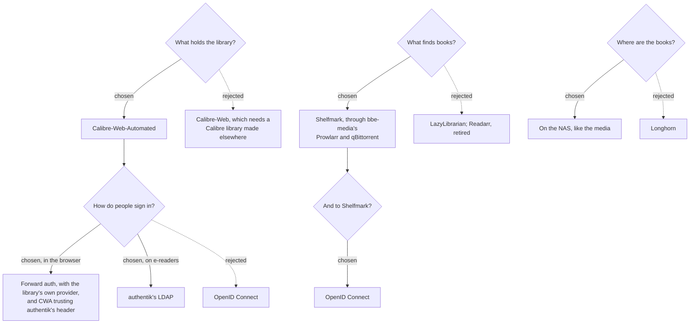

# 0004: A book library with Calibre-Web-Automated and Shelfmark

**Status:** proposed, 2026-10-16

## Context

bbe-media covers shows and movies. Books need the same: somewhere to keep and read them, a way to find and download new ones, and signing in with the same people and passwords as every other app ([0002](0002-single-sign-on.md)). E-readers matter as much as browsers: Kobo devices, KOReader and OPDS apps sign in with a username and password.

Readarr, the Sonarr for books, was retired in June 2025, so nothing does for books what bbe-media's apps do for shows.

## Decision tree



## Decisions

### 1. Calibre-Web-Automated holds the library

[Calibre-Web-Automated](https://github.com/crocodilestick/Calibre-Web-Automated) (CWA) 4.0.8 is Calibre-Web with Calibre built in:
- It reads, converts and fetches details for books dropped in its ingest folder, adds them to the library, and empties the folder.
- People read in the browser, download, and keep shelves. E-readers use its OPDS feed, Kobo sync and KOReader sync.
- It's a linuxserver-style image. It starts as root and runs as the NAS user from `PUID` and `PGID`, like bbe-media's apps. The `baseline` pod security level allows that.

Rejected: **Calibre-Web** itself, which needs a Calibre library made and kept with Calibre's desktop app. **Calibre-Web NextGen**, a community fork that ships CWA's open fixes, stays the fallback if CWA goes quiet again, as it did for six months before 4.0.7. Switching would mostly be the image.

### 2. Shelfmark finds books, through bbe-media

[Shelfmark](https://github.com/calibrain/shelfmark) 1.3.0 searches for books and downloads them into CWA's ingest folder:
- **Torrents:** it searches bbe-media's Prowlarr in its book categories and downloads with bbe-media's qBittorrent, in the `books` category. qBittorrent keeps seeding, and Shelfmark copies the book out.
- **Direct downloads and IRC:** it can download from Anna's Archive, Library Genesis, Z-Library and Welib, and ask a search bot on IRC. It ships without their addresses, so they're used once the values give mirrors or a server (`bbe.library.shelfmark.directDownload`, `irc`). Direct downloads get past Cloudflare with bbe-media's FlareSolverr, so the chart runs Shelfmark's lite image, without a browser of its own.
- **Book details** come from Open Library, which needs no key, or Hardcover with one.
- `bbe-media` is a prerequisite, as that's where Prowlarr and qBittorrent are.

Shelfmark is maintenance-only since May 2026, so the chart pins 1.3.0. Whether people request books for admins to approve (`bbe.library.shelfmark.requests`) is recorded in `bbe.yaml`, with the people CronJob's schedule (bbe-quest's `bbe/recorded-values`). Rejected: **LazyLibrarian**, which is maintained and works with Prowlarr, but is built around its own library rather than CWA's ingest. **Bookshelf** and **Chaptarr**, Readarr's successors, are too young.

### 3. The books are on the NAS

`bbe-library` asks for an NFS share and a NAS user (`bbe.library.nfs`, `bbe.library.user`), as bbe-media does (0001, decisions 5 and 8). It can be bbe-media's share:

```
books/          The Calibre library: its books and metadata.db
books-ingest/   What's waiting to be added, which CWA empties
```

- **The library's metadata.db is SQLite, on NFS.** That goes against 0001's decision 6. It's acceptable here as CWA is its only writer, and it runs with `NETWORK_SHARE_MODE`: no SQLite WAL, no `chown` of the share, and polling for new books, as inotify doesn't see what other pods write. Its own databases, its users and settings, stay on Longhorn.
- **Nothing goes through the share as root.** CWA would look for or create a library as root, which a share mapping root away refuses. A Job creates the folders and an empty library as the NAS user, CWA's own library search is off (`DISABLE_LIBRARY_AUTOMOUNT`), and the setup Job points CWA at `/calibre-library`.
- **Only the NAS user goes into the share**, which is mounted whole, as bbe-media mounts its own. A Synology share's own folder can let nobody but its owner in, and root is mapped away. On `present-sprite`, the kubelet, which resolves sub-paths as root, couldn't mount `books/` as a sub-path, and the NAS refused mounting it as a subfolder. CWA's start also runs as root, and stops unless it can read its library folder. So CWA's `dirs.json` names `/share/books` and `/share/books-ingest`, and its start checks the image's own empty `/calibre-library`. Its other root steps on the share, setting owners, are skipped with `NETWORK_SHARE_MODE`, or fail without stopping it.
- **Shelfmark mounts bbe-media's share read-only at /media**, where qBittorrent puts its downloads, as it finds a finished download by the path qBittorrent reports. The chart copies the share's address from bbe-media's volume. The NAS user is best bbe-media's, so it can read them.

Rejected: **Longhorn**, safer for metadata.db, but the books would only be on the node's disk.

### 4. People sign in to CWA with authentik: forward auth in the browser, LDAP on e-readers

Whoever is in authentik's `users` or `admins` gets in, and nobody else. Nobody is added to CWA by hand: CWA creates people on their first visit, and new people may download, read and keep shelves.

**In the browser, Traefik's forward auth signs people in,** as for Sonarr, and CWA trusts who authentik names:
- **Its own provider.** bbe-auth's forward auth for the domain only lets `admins` in ([0002](0002-single-sign-on.md), decision 7). So bbe-auth's blueprint adds a provider for `calibre.<domain>` only (`forward_single`), which lets in `users` and `admins`. The embedded outpost picks a provider for a host before the domain's.
- **Its sign-in comes back to the library's host,** at `/outpost.goauthentik.io/`, where authentik sets its cookie for that host. bbe-auth's Ingress sends that path to authentik, ahead of the library's, as its path is longer.
- **CWA signs in whoever `X-authentik-username` names** ("Allow Reverse Proxy Authentication"), and creates them if they're new. It does that on every request, so signing out of CWA does nothing: people sign out of authentik.
- **Only Traefik's forward auth sets that header.** A middleware removes authentik's headers from every request to the library before forward auth, which sets them again. And the library's NetworkPolicy only lets Traefik and bbe's setup reach CWA, not Shelfmark nor any other pod.

**E-readers sign in with LDAP,** through bbe-auth's LDAP outpost, as Jellyfin's apps do. They can't sign in through a browser, so their paths skip forward auth, with authentik's headers still removed:

| Path | What uses it | How it's checked |
|---|---|---|
| `/opds` | OPDS apps, such as KOReader | Their authentik username and password, against LDAP |
| `/kosync` | KOReader's progress sync | The same |
| `/kobo/`, `/api/v3/`, `/api/UserStorage/` | Kobo sync, and the Kobo reading services it passes on | A token each person makes on their profile page, which is behind forward auth |

`/kobo/` keeps its slash, as Traefik matches path prefixes as text, and `/kobo_auth`, where people make their token, is a page behind forward auth.

CWA's login stays LDAP, which OPDS and KOReader's sync check passwords with. It can only be one of LDAP and OpenID Connect.
- The library binds with its own account, `books-ldap`, which bbe-auth's blueprint creates with Jellyfin's. CWA's "OpenLDAP" setting is on, so it binds with the DN its search finds, as authentik's entries have no Active Directory `distinguishedName`.
- **CWA has no admin group of its own**, so the setup asks LDAP who is in `admins` and keeps admin rights for exactly them, among the people in LDAP. A CronJob runs that part of the setup every 10 minutes (`bbe.setup.peopleSchedule`), as CWA creates people on their first sign-in.
- **Books are sent to people's own email.** The same CronJob sets someone's Send to eReader address to their email in authentik, read from LDAP, when they have one and haven't set another. It's not read from CWA, which makes up `<username>@localhost` for the people forward auth creates.
- **The library's own admin** (`bbe.admin.username`) isn't in authentik, so it signs in with its own password, generated into `bbe-library-admin`. It's what the setup signs in with, straight to CWA's Service. It's the way in when authentik can't help, through `kubectl port-forward`, as Traefik's forward auth lets nobody through without authentik. CWA's default `admin` is renamed to it, with that password.

Rejected:
- **OpenID Connect**, which CWA 4 has, with admins by group. CWA's login would be OpenID Connect instead of LDAP, so people would have no password for OPDS and KOReader's sync. And people would still press its sign-in button, where forward auth signs them in when they open it.
- **LDAP alone**, as before. People typed their authentik password into CWA's own form, rather than being signed in by authentik's session like the other apps.
- **Forward auth on every path.** E-readers can't sign in through a browser, so they'd be kept out.

### 5. People sign in to Shelfmark with OpenID Connect

Shelfmark is only used in the browser. bbe-auth's blueprint adds an OAuth2 provider for it, which `users` and `admins` may use, and the client secret is generated into `bbe-auth-authentik`, which bbe-library copies.
- `admins` are Shelfmark's admins, from the `groups` claim of authentik's profile scope.
- Shelfmark's own logins are off (`DISABLE_LOCAL_AUTH`). Without that, it would run with no login at all until a local admin existed.
- Shelfmark reaches authentik at `https://auth.<domain>`, which authentik names in its tokens. Pods don't resolve the domain, so a host alias points it at Traefik's IP, and its certificates are Python's with bbe's CA added.
- Rejected: **forward auth**. The domain's only lets `admins` in (0002, decision 7), and Shelfmark's OpenID Connect already signs people in with authentik's session, so it needs no provider of its own, as the library does (decision 4).

### 6. The setup posts CWA's admin forms

CWA has no API for its settings. The setup Job signs in like a browser and posts its forms back:
- A form saves every field it's sent, and an unticked checkbox isn't sent, so each form is read first and sent back whole, changed only where bbe needs it.
- It reads before it writes, so a second run changes nothing. CWA allows three logins a minute per username, so it keeps its session rather than signing in again.
- It runs on CWA's own image, for the python-ldap it searches authentik's groups with.

### 7. CWA serves HTTPS itself, even behind Traefik

Traefik ends people's HTTPS with the domain's certificate, and connects to CWA over HTTPS again, so nothing in the cluster talks to CWA in plain HTTP:
- **CWA's certificate is from bbe's certificate authority**, through the `bbe-ca` ClusterIssuer bbe-networking adds for apps in other namespaces. It names CWA's Service, and cert-manager renews it. CWA's server, gevent, reads it on every connection, so a renewal needs no restart.
- **CWA's own settings name it** (Basic Configuration, "SSL certfile location" and "SSL Keyfile location"). CWA reads them when it starts, so an init container sets them in its database before it starts. On a first install that container creates the database first, with `cps.py -d`, as CWA's own start does. It doesn't copy CWA's `empty_library/app.db`, which carries a session key that every install would share.
- **Traefik checks the certificate** with a ServersTransport trusting bbe's certificate authority, for the Service's name. bbe's setup checks it the same way, with only the certificate authority mounted, not CWA's key.
- **CWA reaches authentik's LDAP over LDAPS** ([0014](0014-encrypting-connections-inside-the-cluster.md)), with bbe's certificate authority. CWA only checks the server's certificate when it's also given a client certificate and key, and otherwise encrypts without checking. So it's given its own server certificate, which the outpost doesn't ask for.
- Rejected: **CWA's `-c` and `-k` flags**, which CWA's start doesn't pass on. And **setting it from the setup Job**, which would leave CWA serving plain HTTP until the setup ran, while its probes and Traefik expect HTTPS.

## Consequences

- **A new admin gets CWA admin rights within 10 minutes** of being added to `admins`, or of their first visit.
- **CWA trusts a header for who's signed in.** It's only safe while Traefik removes it from what people send and only Traefik and bbe's setup reach CWA. On a cluster that doesn't enforce NetworkPolicies, any pod reaching CWA's Service could sign in as anyone.
- **CWA's start logs a `Gevent SSL Error`** each time, from its own check that its port is open, which connects without TLS.
- **The library can't be reached through Traefik while authentik is down,** e-readers' paths aside. Its own admin signs in through a port-forward.
- **Publishing the library through Cloudflare** ([0008](0008-public-access-through-cloudflare.md)) needs a provider of its own for its public host too, and the same header removal on the public entrypoint.
- **Books Shelfmark downloads are copies.** qBittorrent keeps seeding its own, in bbe-media's downloads, in its `books` category, until it's removed there.
- **CWA keeps its databases on Longhorn, and the library on NFS.** Restoring one without the other loses users' reading progress and shelves, not books.
- **Uninstalling `bbe-library`** deletes its namespace with people's shelves and reading progress. The books on the share stay.
- **What's verified, and what isn't:**
  - **Against the apps' source only,** CWA 4.0.8 and Shelfmark 1.3.0: CWA's settings forms, LDAP login, OPDS checking passwords against LDAP, its first start as root and what `NETWORK_SHARE_MODE` changes.
  - **Against CWA 4.0.8's source, in the cluster's pod, on 2026-11-11:** signing in from a reverse proxy's header on every request and creating people from it, its three settings, that its login is one of LDAP and OpenID Connect, and the paths of OPDS, Kobo sync, the Kobo reading services and KOReader's sync. That authentik's LDAP gives people's `mail`, on the cluster.
  - **Run on a test cluster on 2026-11-11,** through Traefik:
    - opening the library sent people to authentik with the library's own provider, not the domain's;
    - someone only in `users` signed in, came back through `/outpost.goauthentik.io/` on the library's host, and CWA created them and let them in, without admin rights;
    - a forged `X-authentik-username` was removed, on the pages and on `/opds`;
    - `/opds` and Kobo sync asked for their password or token, rather than sending people to authentik;
    - the people CronJob gave that person their email in authentik as their Send to eReader address, not CWA's `<username>@localhost`.
  - **Not checked:** the library's NetworkPolicy, as that cluster didn't enforce NetworkPolicies, and KOReader's sync, which is off in CWA's settings until someone turns it on. Shelfmark's settings from the environment, its OpenID Connect sign-in and callback, and how it finds and copies qBittorrent's downloads.
  - **Unit tests** cover the charts, and the setup's form reading was checked against CWA's form markup.
  - **Not run yet:** CWA and Shelfmark themselves, the setup Job against CWA, an LDAP sign-in, an e-reader, a Shelfmark sign-in through authentik, and a download through qBittorrent. Docker was unavailable, and nothing was installed on the cluster.
