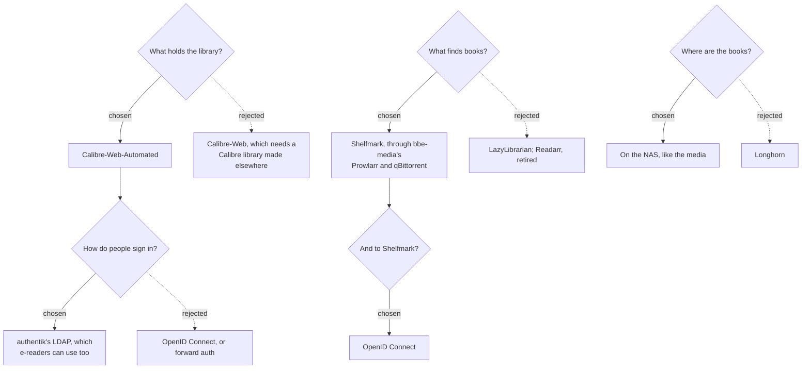

# 0004: A book library with Calibre-Web-Automated and Shelfmark

**Status:** proposed, 2026-10-16

## Context

bbe-media covers shows and movies. Books need the same: somewhere to keep and read them, a way to find and download new ones, and signing in with the same people and passwords as every other app ([0002](0002-single-sign-on.md)). E-readers matter as much as browsers: Kobo devices, KOReader and OPDS apps sign in with a username and password.

Readarr, the Sonarr for books, was retired in June 2025, so nothing does for books what bbe-media's apps do for shows.

## Decision tree



## Decisions

### 1. Calibre-Web-Automated holds the library

[Calibre-Web-Automated](https://github.com/crocodilestick/Calibre-Web-Automated) (CWA) 4.0.8 is Calibre-Web with Calibre built in:
- It reads, converts and fetches details for books dropped in its ingest folder, adds them to the library, and empties the folder.
- People read in the browser, download, and keep shelves. E-readers use its OPDS feed, Kobo sync and KOReader sync.
- It's a linuxserver-style image. It starts as root and runs as the NAS user from `PUID` and `PGID`, like bbe-media's apps. The `baseline` pod security level allows that.

Rejected: **Calibre-Web** itself, which needs a Calibre library made and kept with Calibre's desktop app. **Calibre-Web NextGen**, a community fork that ships CWA's open fixes, stays the fallback if CWA goes quiet again, as it did for six months before 4.0.7. Switching would mostly be the image.

### 2. Shelfmark finds books, through bbe-media

[Shelfmark](https://github.com/calibrain/shelfmark) 1.3.0 searches for books and downloads them into CWA's ingest folder:
- **Torrents:** it searches bbe-media's Prowlarr in its book categories and downloads with bbe-media's qBittorrent, in the `books` category. qBittorrent keeps seeding, and Shelfmark copies the book out.
- **Direct downloads and IRC:** it can download from Anna's Archive, Library Genesis, Z-Library and Welib, and ask a search bot on IRC. It ships without their addresses, so they're used once the values give mirrors or a server (`bbe.library.shelfmark.directDownload`, `irc`). Direct downloads get past Cloudflare with bbe-media's FlareSolverr, so the chart runs Shelfmark's lite image, without a browser of its own.
- **Book details** come from Open Library, which needs no key, or Hardcover with one.
- `bbe-media` is a prerequisite, as that's where Prowlarr and qBittorrent are.

Shelfmark is maintenance-only since May 2026, so the chart pins 1.3.0. Rejected: **LazyLibrarian**, which is maintained and works with Prowlarr, but is built around its own library rather than CWA's ingest. **Bookshelf** and **Chaptarr**, Readarr's successors, are too young.

### 3. The books are on the NAS

`bbe-library` asks for an NFS share and a NAS user (`bbe.library.nfs`, `bbe.library.user`), as bbe-media does (0001, decisions 5 and 8). It can be bbe-media's share:

```
books/          The Calibre library: its books and metadata.db
books-ingest/   What's waiting to be added, which CWA empties
```

- **The library's metadata.db is SQLite, on NFS.** That goes against 0001's decision 6. It's acceptable here as CWA is its only writer, and it runs with `NETWORK_SHARE_MODE`: no SQLite WAL, no `chown` of the share, and polling for new books, as inotify doesn't see what other pods write. Its own databases, its users and settings, stay on Longhorn.
- **Nothing goes through the share as root.** CWA would look for or create a library as root, which a share mapping root away refuses. A Job creates the folders and an empty library as the NAS user, CWA's own library search is off (`DISABLE_LIBRARY_AUTOMOUNT`), and the setup Job points CWA at `/calibre-library`.
- **Only the NAS user goes into the share**, which is mounted whole, as bbe-media mounts its own. A Synology share's own folder can let nobody but its owner in, and root is mapped away. On `present-sprite`, the kubelet, which resolves sub-paths as root, couldn't mount `books/` as a sub-path, and the NAS refused mounting it as a subfolder. CWA's start also runs as root, and stops unless it can read its library folder. So CWA's `dirs.json` names `/share/books` and `/share/books-ingest`, and its start checks the image's own empty `/calibre-library`. Its other root steps on the share, setting owners, are skipped with `NETWORK_SHARE_MODE`, or fail without stopping it.
- **Shelfmark mounts bbe-media's share read-only at /media**, where qBittorrent puts its downloads, as it finds a finished download by the path qBittorrent reports. The chart copies the share's address from bbe-media's volume. The NAS user is best bbe-media's, so it can read them.

Rejected: **Longhorn**, safer for metadata.db, but the books would only be on the node's disk.

### 4. People sign in to CWA with authentik's LDAP

CWA's login uses LDAP, through bbe-auth's LDAP outpost, as Jellyfin's does:
- People in `users` or `admins` sign in with their authentik password, in the browser and on e-readers. CWA's OPDS feed checks passwords against LDAP too. Kobo devices use a token each person makes in their profile.
- The library binds with its own account, `books-ldap`, which bbe-auth's blueprint creates with Jellyfin's. CWA's "OpenLDAP" setting is on, so it binds with the DN its search finds, as authentik's entries have no Active Directory `distinguishedName`.
- CWA creates people on their first sign-in. New people may download, read and keep shelves.
- **CWA has no admin group of its own**, so the setup Job asks LDAP who is in `admins` and keeps admin rights for exactly them, among the people in LDAP. It runs on every install and upgrade, so a new admin gets their rights on the next upgrade.
- **The library's own admin** (`bbe.admin.username`) isn't in LDAP, so it signs in with its own password, generated into `bbe-library-admin`. It's what the setup signs in with, and the way in when authentik can't help. CWA's default `admin` is renamed to it, with that password.

Rejected:
- **OpenID Connect**, which CWA 4 has, with admins by group. People would have no password for their e-readers.
- **Forward auth**, which would keep e-readers out altogether.

### 5. People sign in to Shelfmark with OpenID Connect

Shelfmark is only used in the browser. bbe-auth's blueprint adds an OAuth2 provider for it, which `users` and `admins` may use, and the client secret is generated into `bbe-auth-authentik`, which bbe-library copies.
- `admins` are Shelfmark's admins, from the `groups` claim of authentik's profile scope.
- Shelfmark's own logins are off (`DISABLE_LOCAL_AUTH`). Without that, it would run with no login at all until a local admin existed.
- Shelfmark reaches authentik at `https://auth.<domain>`, which authentik names in its tokens. Pods don't resolve the domain, so a host alias points it at Traefik's IP, and its certificates are Python's with bbe's CA added.
- Rejected: **forward auth**, which only lets `admins` in (0002, decision 7).

### 6. The setup posts CWA's admin forms

CWA has no API for its settings. The setup Job signs in like a browser and posts its forms back:
- A form saves every field it's sent, and an unticked checkbox isn't sent, so each form is read first and sent back whole, changed only where bbe needs it.
- It reads before it writes, so a second run changes nothing. CWA allows three logins a minute per username, so it keeps its session rather than signing in again.
- It runs on CWA's own image, for the python-ldap it searches authentik's groups with.

## Consequences

- **A new admin gets CWA admin rights on the next install or upgrade**, not when they're added to `admins`.
- **Books Shelfmark downloads are copies.** qBittorrent keeps seeding its own, in bbe-media's downloads, in its `books` category, until it's removed there.
- **CWA keeps its databases on Longhorn, and the library on NFS.** Restoring one without the other loses users' reading progress and shelves, not books.
- **Uninstalling `bbe-library`** deletes its namespace with people's shelves and reading progress. The books on the share stay.
- **What's verified, and what isn't:**
  - **Against the apps' source only,** CWA 4.0.8 and Shelfmark 1.3.0: CWA's settings forms, LDAP login, OPDS checking passwords against LDAP, its first start as root and what `NETWORK_SHARE_MODE` changes. Shelfmark's settings from the environment, its OpenID Connect sign-in and callback, and how it finds and copies qBittorrent's downloads.
  - **Unit tests** cover the charts, and the setup's form reading was checked against CWA's form markup.
  - **Not run yet:** CWA and Shelfmark themselves, the setup Job against CWA, an LDAP sign-in, an e-reader, a Shelfmark sign-in through authentik, and a download through qBittorrent. Docker was unavailable, and nothing was installed on the cluster.
