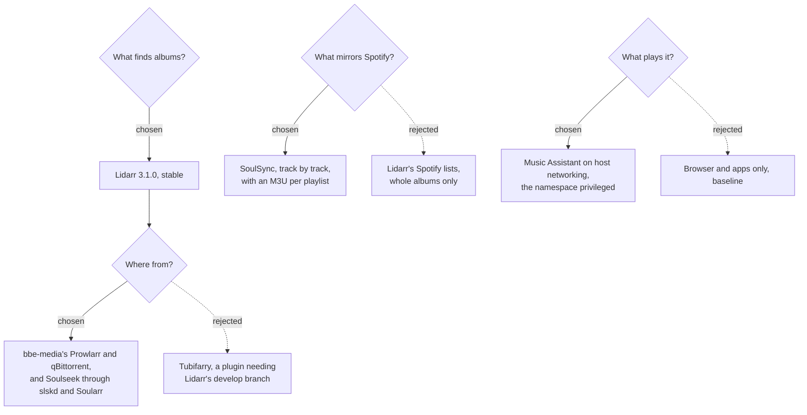

# 0005: Music with Lidarr, Soulseek, SoulSync and Music Assistant

**Status:** proposed, 2026-10-19

## Context

Shows, movies and books each have a package. Music needs one too:
- **Find and download music**, the way Sonarr and Radarr do for shows and movies.
- **Play it** on the speakers in the house, in the browser and on phones.
- **Keep a local copy of a Spotify library**, kept in step with it, so the music keeps playing when Spotify is down.

The music lives on the NAS, written as the NAS user, like bbe-media's and bbe-library's (0001, decisions 5 and 8; 0004, decision 3). Apps sign people in with authentik where they can (0002).

Things that shaped what follows, as of October 2026:
- **Lidarr** only manages whole albums. Its stable release, 3.1.0, is from November 2025, and plugins are only in its develop branch. Its metadata server, rebuilt after the 2025 outage, still searches by name poorly.
- **Public torrent trackers** find relatively few correctly tagged albums. Soulseek is where most music is.
- **Spotify** (February 2026): a developer app needs its owner to have Premium, and only reads playlists its users own or collaborate on. Its refresh tokens expire after six months (July 2026).
- **Music Assistant** only finds speakers with host networking, and has no OIDC or LDAP.

## Decision tree



## Decisions

### 1. Lidarr finds albums, through bbe-media and Soulseek

Lidarr 3.1.0 from linuxserver, as an app chart like Sonarr's (`charts/lidarr`):
- bbe-media's Prowlarr shares its indexers with it, and it downloads with bbe-media's qBittorrent, in the `music` category. Lidarr 3.1.0 can't use qBittorrent's API key, so it signs in as bbe-media's admin.
- **Soulseek:** Soularr looks for the albums Lidarr is missing on Soulseek through slskd, then has Lidarr import what it downloaded.
- It's behind authentik's forward auth for `admins`, like Sonarr (0002, decision 7). Its own login stays for going back to it.

Rejected: **Tubifarry**, a Lidarr plugin adding Soulseek and YouTube, as it needs Lidarr's develop branch, and moving off it needs a database restore.

### 2. slskd is on Soulseek, at an address of its own

slskd 0.26.1, the Soulseek client Soularr and SoulSync download with:
- **Its account is generated** (`bbe` and 12 random characters) and registered by Soulseek on its first login. A name unused for 30 days is freed.
- **It shares the music folder**, as Soulseek expects, with at most 4 uploads at 2 MiB/s (`bbe.music.slskd.uploadSlots`, `uploadSpeedLimit`).
- **Peers reach it at its own LAN address** (`bbe.music.slskd.loadBalancerIP`, which bbe asks for), in a MetalLB pool bbe-music adds to bbe-networking's namespace. The router has to forward the listen port, 50300, to it. Without that, slskd only reaches peers whose own port is open. The Service keeps peers' own addresses (`externalTrafficPolicy: Local`).
- **Its own login stays on**, behind authentik's forward auth. It has no OIDC, LDAP or trusted header, and its maintainer suggests turning its login off behind a proxy, but the cluster doesn't enforce NetworkPolicies (0002, decision 7), so anything in the cluster could reach it. Soularr and SoulSync use its API key.
- Soulseek's rules don't allow automated clients like Soularr. It's at the user's own risk.

### 3. SoulSync mirrors Spotify track by track

SoulSync 3.5.7 mirrors liked songs, playlists and followed artists, downloading each track rather than its whole album:
- **Sources:** Soulseek through slskd first, then bbe-media's Prowlarr and qBittorrent.
- **Torrents seed to ratio 2**, which it hands to qBittorrent, like everything else there (0001).
- **It writes to `music-spotify/`** on the share, with an M3U per playlist, which Music Assistant reads. No media server is involved ("Standalone").
- **Setup:** it makes its own API keys. The setup Job asks for its first one and keeps it in `bbe-music-soulsync-key`, the only Secret its ServiceAccount may change. It then sets its sources, folders, M3U export and the address Spotify's login comes back to.
- **What stays manual**, as Spotify requires it: creating a Spotify developer app with a Premium account, putting its ID and secret in SoulSync, signing in (again every six months), and choosing the playlists to mirror. Playlists others own can't be read, so they need copying to one's own first.
- It's behind authentik's forward auth. It has no OIDC or LDAP. The header it trusts only skips its launch PIN, which is off.
- It releases every few days, so it's pinned.

Rejected: **Lidarr's Spotify lists**, which add whole albums and skip liked songs.

### 4. Music Assistant plays it all, on the node's network

Music Assistant 2.10.7:
- **Local files:** one provider for Lidarr's `music/` and one for SoulSync's `music-spotify/`, which also reads its playlists. They're mounted read-only.
- **Spotify:** with its own provider, which needs Premium and a sign-in in its settings, it links each Spotify track to the local copy, by MusicBrainz ID or ISRC, and plays the best one there is. When Spotify is down, that's the local one.
- **Host networking:** speakers are found by multicast, and AirPlay and Cast call back on ports of their own, so it runs on the node's network. That needs `bbe/pod-security: privileged` for the namespace, which every pod in it then gets. Kubernetes is unsupported upstream.
- **It runs as the NAS user** rather than root, which the share maps away. Its image is prepared for that.
- **Sign-in:** its accounts are its own, as it only has its own and Home Assistant's. The setup creates its admin with a generated password, claiming it before anyone else can. People are added in its settings. Its apps connect to `music.<domain>` directly, so it's not behind forward auth.
- **When OIDC lands upstream** (music-assistant/backlog#189), it can sign people in with authentik.

Rejected: **no host networking**, which keeps `baseline`, but only plays in the browser, its apps and players added by address.

### 5. The share is mounted whole

Every app mounts the share at `/media`, as bbe-media does, so Lidarr finds qBittorrent's downloads where qBittorrent reports them, and imports them as hardlinks. It should be bbe-media's share, as the NAS user that writes it:

```
music/                      Lidarr's root folder, Music Assistant's first provider, what slskd shares
music-spotify/              SoulSync's mirror and its playlists
downloads/soulseek/         slskd's downloads, which Soularr and SoulSync move from
```

A folders Job creates them as the NAS user. The databases are on Longhorn.

## Consequences

- **The router has to forward port 50300** to slskd's address, which bbe can't do.
- **Every pod in bbe-music may run privileged**, as pod security is set per namespace.
- **People sign in to Music Assistant with its own accounts**, separate from authentik, until it supports OIDC.
- **Spotify asks SoulSync to sign in again every six months.**
- **Albums and tracks can be in both folders**, from Lidarr and SoulSync. Music Assistant links them as one.
- **slskd asks for its own login** after authentik's, so admins sign in twice there.
- **What's verified, and what isn't:** against the apps' source only, and unit tests. Nothing has run yet.
