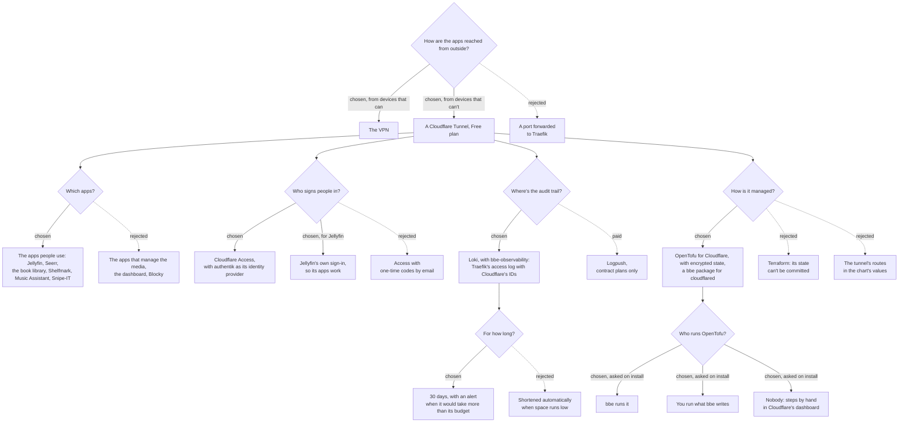

# 0008: Reaching apps from outside through Cloudflare

**Status:** proposed, 2026-10-23

## Context

The apps are only reachable on the house's network, at `<app>.bbe.home.arpa` ([0002](0002-single-sign-on.md), decision 6). Devices that can run a VPN reach them from outside through it. Some can't, such as a TV away from home or a computer that doesn't allow one. From those, the cluster's owner, and nobody else, should still reach the apps, without opening the house to the internet.

What that access must have:
- **No open ports on the router**, and nothing on the internet that reaches the cluster directly.
- **Audited:** who reached which app, when and from where, kept somewhere we control.
- **Logged** per request, so an incident can be traced.
- **Rate limited**, so nobody can guess passwords or flood an app.
- **IP blocking**, for addresses that abuse it.
- **Managed as code:** what's public, who's allowed in and what's blocked are all in git and reviewed. Nothing is configured by hand.
- **Free:** no paid plans or services for now.

Things that shaped what follows, checked against Cloudflare's and OpenTofu's documentation on 2026-10-23:
- **Cloudflare Tunnel connects outbound from the cluster.** The router keeps every port closed, and Cloudflare's edge is the only thing on the internet.
- **Cloudflare decrypts everything that passes through it.** It sees every request in full.
- **Cloudflare's terms forbid serving video through its CDN**, or a disproportionate share of audio or other large files, unless you use its paid video products or have an Enterprise plan. It can limit an account that does.
- **The Free plan's limits are small:**
  - **Rate limiting:** 1 rule, counting per IP over 10 seconds and blocking for 10 seconds.
  - **WAF custom rules:** 5.
  - **Custom IP lists:** 1 list, with 10,000 items.
- **Cloudflare Access is free for up to 50 users.** It keeps its sign-in logs for 24 hours on the Free plan. Exporting Cloudflare's logs with Logpush needs a contract or Enterprise plan.
- **Access signs people in through a browser.** Jellyfin's TV and phone apps can't get through it.
- **Universal SSL only covers the domain and one level below it**, so `seerr.example.org` is covered and `seerr.bbe.example.org` isn't.
- **Cloudflare's provider** is at 5.28.1, in OpenTofu's registry as well as Terraform's. It manages tunnels and their routing, DNS, Access, WAF rulesets and lists.
- **OpenTofu (1.13.2) encrypts its state and plans itself,** with the local backend too.
  - **How:** AES-GCM, with a key derived from a passphrase of at least 16 characters (PBKDF2).
  - **The passphrase** can come from a variable, so it doesn't have to be in any file.
  - **Terraform** only encrypts state through the backend it's stored in.
- **`bbe-observability` sends every pod's output to Loki**, through Alloy, and keeps it for 15 days on a 10Gi volume ([0006](0006-observability.md)). Alloy labels each line with its namespace, pod, container and app. Loki's compactor deletes by age, per stream if asked, but never by size.
- **NetworkPolicies are enforced** on clusters set up since bbe-quest#56 ([0007](0007-network-policies.md)).

## Decision tree

## Decisions

### 1. A tunnel for devices that can't use the VPN, and nothing else is opened

The VPN stays how devices that can run one reach everything from outside. The tunnel only publishes the apps that are opted in (decision 2), to the owner (decision 4). The router forwards no ports, and UPnP is off.

Everything runs on Cloudflare's Free plan. Each decision says what that limits.

Rejected: **forwarding a port to Traefik.** Every app, and every app's bugs, would be reachable by anyone, with nothing in front to rate limit or block. Moving the cluster's address would also mean changing the DNS.

### 2. The apps people use are published, and opted in one by one

| App | Published? | Behind Access? |
|---|---|---|
| Jellyfin | Yes | No, so its TV and phone apps work (decision 4) |
| Seerr | Yes | Yes |
| Calibre-Web-Automated | Yes | Yes |
| Shelfmark | Yes | Yes |
| Music Assistant | Yes | Yes |
| Snipe-IT | Yes | Yes ([0009](0009-snipe-it.md)) |
| authentik (`auth`) | Yes, as the sign-in | No, Access sends people to it (decision 4) |
| Sonarr, Radarr, Prowlarr, Bazarr, qBittorrent | No | Managing the media is done through the VPN |
| Grafana, the dashboard, Blocky | No | They're for the house's network |

Nothing is published by default. An app opts in with a setting naming its public host, under the package's `bbe/settings`.

Streaming Jellyfin and Music Assistant through Cloudflare goes against its terms (Context). It's one person's streaming, so it's a small share of traffic, but Cloudflare can still limit the account. Streaming through the VPN, where a device can run it, avoids that.

### 3. A public domain, with apps one level below it

The published apps get public names in a domain on Cloudflare, one level below it: `jellyfin.<public domain>`. Universal SSL covers them for free. Inside the house they keep their `bbe.home.arpa` names.

This is the public domain [0002](0002-single-sign-on.md) left for later (decision 6). Cloudflare holds its certificate at the edge. Between cloudflared and Traefik, the traffic stays on bbe's own certificate authority (decision 8).

### 4. Cloudflare Access in front, signing in with authentik, except Jellyfin

Every published app except Jellyfin is a Cloudflare Access application. Access uses authentik as its OpenID Connect identity provider, so it's the same account as at home. Its policy only lets in members of a new authentik group, `remote`.
- **One sign-in.** authentik remembers the session, so the apps behind forward auth let you straight through after Access.
- **People are still managed in one place:** authentik, and `bbe configure bbe-auth` ([0002](0002-single-sign-on.md), decision 9).
- **cloudflared checks Access's token** (`access.required`, with the application's audience tag) before passing a request on. A published app that's missing from Access is refused, not left open.

Two hostnames are published without Access, and are the only pages anyone can reach:

| | Why | What protects it |
|---|---|---|
| authentik | Access sends people there to sign in | The rate limit (decision 6), authentik's reputation policy, and a second factor for admins |
| Jellyfin | Its TV and phone apps can't sign in through a browser | The rate limit (decision 6), and its own sign-in through authentik's LDAP. Jellyfin only lets `users` and `admins` in ([0002](0002-single-sign-on.md), decision 7) |

Both are also behind the country rule and the block list (decision 7).

**bbe-media's generated admin stays home-only.** Jellyfin is told Traefik is its proxy (`KnownProxies`), so it sees the real client address. Remote access is then turned off for that account. It signs in with Jellyfin's own password, not through authentik, so nothing else would guard it.

Rejected:
- **Access in front of Jellyfin too.** It would be better protected, but its TV and phone apps couldn't connect, and they're why it's published.
- **Access's one-time codes by email.** It would mean keeping a second list of people in Cloudflare, and the apps behind forward auth would still send people to authentik.

### 5. The audit trail is in Loki, with Cloudflare's IDs in it

Cloudflare's logs are a day long on the Free plan, and exporting them needs a contract plan. The record we keep is at the origin, and goes to Loki when `bbe-observability` is installed:

| Where | What it records |
|---|---|
| Traefik's access log, JSON, for the public entrypoint only (decision 8) | Every request: time, host, path, status and duration. It also records Cloudflare's headers: `Cf-Connecting-IP` (who), `Cf-Access-Authenticated-User-Email` (which person, behind Access) and `Cf-Ray`, which finds the same request in Cloudflare's dashboard |
| cloudflared's output | The tunnel's connections to Cloudflare, and requests refused for lacking Access's token |
| authentik's and Jellyfin's output | What they log of sign-ins. Each also keeps its own record (authentik's events, Jellyfin's activity log), with the client's address |
| Cloudflare's Access and security events | Sign-ins allowed and refused, requests blocked or rate limited, for 24 hours. Looked up by `Cf-Ray` |

Nothing extra ships the logs. Traefik writes its access log to its output, and Alloy sends every pod's output to Loki ([0006](0006-observability.md), decision 1). In Grafana, a request is found by `Cf-Ray`, an address or a person's email. Loki keeps them for 30 days, longer than other logs (decision 11).

`bbe-observability` scrapes cloudflared's metrics with a PodMonitor of its own, as it does for the other packages (0006, decision 3).

Without `bbe-observability`, the logs are only in the pods' output, and gone when a pod is replaced. authentik's and Jellyfin's own records remain.

authentik and Jellyfin only see the real client address if Traefik passes it on. The public entrypoint trusts the forwarded headers it gets from cloudflared, and authentik already trusts Traefik's, which come from a private address.

Rejected: **Logpush to our own storage.** It's the complete record, but it needs a contract plan.

### 6. Rate limits at the edge and at Traefik

- **At Cloudflare:** the Free plan's single rule covers both sign-ins anyone can reach, at 10 requests per IP in 10 seconds:
  - authentik's flows;
  - Jellyfin's `/Users/AuthenticateByName`.

  One rule can match both, as its expression is any filter. It stops a flood before it reaches the house.
- **At Traefik:** a `RateLimit` middleware on the public entrypoint's routers. It counts per `Cf-Connecting-IP` (`sourceCriterion.requestHeaderName`), so it limits each client rather than cloudflared. Traefik's limits can use whatever rate and period we choose. Jellyfin's streams make many requests, so its router gets a looser limit than the sign-ins.
- **At authentik:** its reputation policy, against guessing passwords slowly.

### 7. Countries are allowed and addresses blocked at Cloudflare, from bbe.yaml

Two of the Free plan's five WAF custom rules:
1. **Only the countries the owner uses are let in,** for every published hostname. It's one person, so anywhere else is someone else. Travelling means adding a country, and removing it after.
2. **`ip.src in $bbe_blocked` is blocked.** `bbe_blocked` is a custom IP list, which holds up to 10,000 addresses and ranges.

The countries and the blocked addresses are `bbe-tunnel`'s settings in `bbe.yaml`, each address with why it's blocked. OpenTofu's configuration is written from them (decision 9). Blocked requests never reach Access, the tunnel or the house.
- **Blocking an address** is `bbe configure bbe-tunnel`, then applying the change (decision 10). Keeping `~/.bbe` in git makes its history the record of who blocked what and why.
- **When it can't wait,** add it in Cloudflare's dashboard, then with `bbe configure`. The next apply removes anything in the list that isn't in `bbe.yaml`.
- **Blocking a person**, whichever address they come from, means removing them from `remote` and `users` in authentik, and revoking their Access sessions.

Rejected: **IP Access rules.** Cloudflare recommends custom rules and lists instead.

### 8. cloudflared runs in a bbe package, and only reaches a separate Traefik entrypoint

A new package, `bbe-tunnel`, runs cloudflared:
- **What it runs:** two replicas of a pinned `cloudflare/cloudflared` image, on the `restricted` pod security level.
- **The token:** it signs in with the tunnel's token, from a Secret. OpenTofu creates the token, or the dashboard when it's set up by hand (decision 10).
- **bbe's CA:** mounted, so cloudflared verifies Traefik's certificate (`caPool`, with `originServerName` in `bbe.home.arpa`) instead of skipping the check.

Traefik in `bbe-networking` gets a separate entrypoint, `public`, which isn't on its LoadBalancer service, so only pods reach it. cloudflared sends everything there.
- **Only the published apps have routers on it,** for their public names. Reaching `public` doesn't reach anything else.
- **It carries the access log, the rate limits** (decisions 5 and 6) **and the trusted forwarded headers.** The house's own entrypoint stays as it is.

**Only cloudflared reaches `public`.** It trusts the forwarded headers it's sent, so any other pod reaching it could claim to be any address. Two NetworkPolicies, following [0007](0007-network-policies.md):

| Package | Pods | Who may reach them |
|---|---|---|
| bbe-networking | Traefik, its `public` port | `bbe-tunnel`'s pods only |
| | Traefik, its other ports | anyone, as now |
| bbe-tunnel | cloudflared, its `metrics` port | `bbe-observability` |

bbe-networking had no policies, as the API server calls its webhooks from the node's network (0007, decision 3). This one only selects Traefik's pods, which no webhook runs in. On clusters that don't enforce NetworkPolicies, any pod can still reach `public`.

Rejected: **Cloudflare's `cloudflare-tunnel-remote` chart** (0.1.2). It runs the `latest` image, takes the token as a plain value, and can't mount bbe's CA.

### 9. Cloudflare is configured with OpenTofu, written by bbe, with encrypted state

Everything on Cloudflare's side is in an OpenTofu module in this repository, `tofu/cloudflare`, released with the charts. It uses Cloudflare's provider 5.28.1:

| Resource | What it holds |
|---|---|
| `cloudflare_zero_trust_tunnel_cloudflared` | The tunnel, managed remotely, and its token |
| `cloudflare_zero_trust_tunnel_cloudflared_config` | Which public name goes to which app, and the origin settings: `caPool`, `originServerName`, and the Access check on every app except Jellyfin and authentik |
| `cloudflare_dns_record` | Each public name, pointing at the tunnel |
| `cloudflare_zero_trust_access_identity_provider` | authentik, through OpenID Connect |
| `cloudflare_zero_trust_access_application`, `cloudflare_zero_trust_access_policy` | An application per app behind Access, allowing `remote` |
| `cloudflare_list`, `cloudflare_list_item` | `bbe_blocked` |
| `cloudflare_ruleset` | The country and blocking rules (`http_request_firewall_custom`), and the rate limit (`http_ratelimit`) |

bbe writes the configuration that uses it into `~/.bbe/cloudflare/`, from `bbe.yaml`:
- the module, pinned to the version of the charts installed;
- the public domain and each published app's public host;
- the countries and the blocked addresses (decision 7).

It's rewritten whenever those change, by `bbe install`, `bbe upgrade` or `bbe configure`. Nobody edits it by hand, so `bbe.yaml` stays the one place that says what's public.

The tunnel's routes are in OpenTofu and not in `bbe-tunnel`'s values. That way the DNS records, Access applications and routes all come from the same configuration, and can't drift apart.

**The state and plans are encrypted, so they're committed with `~/.bbe`.** They hold the tunnel's token and the identity provider's secret:
- **How:** the configuration encrypts both with `aes_gcm`, from a `pbkdf2` key, with `enforced = true` so nothing is ever written unencrypted.
- **The passphrase:** bbe generates it on install, at 32 characters, and shows it once, like bbe-auth's first passwords. You keep it, in a password manager. bbe never saves it: it's read from `TF_VAR_state_passphrase`, or asked for each time.
- **Changing the passphrase** is a `fallback` to the old one for one apply.
- **No backend:** the state stays in `~/.bbe/cloudflare/`, and git is its backup, so a paid backend isn't needed.

The Cloudflare API token can only edit this zone, and the account's Zero Trust and tunnels. It's never saved by bbe either: it's read from `CLOUDFLARE_API_TOKEN`, or asked for each time.

Rejected:
- **Terraform.** Its state can only be encrypted by the backend it's stored in, so it would have to stay out of git, on one machine.
- **Routes in `bbe-tunnel`'s values (a locally managed tunnel).** It would split what's public between the chart and OpenTofu, which still has to create the DNS records and Access applications.
- **A configuration each installation writes itself.** Every installation would rewrite the same resources, and fixes to them wouldn't reach anyone.

### 10. On install, you choose who sets up Cloudflare's side

`bbe install bbe-tunnel` asks how Cloudflare's side is set up, and keeps the answer in `bbe.yaml`:

| Choice | What bbe does | What you do |
|---|---|---|
| **bbe runs OpenTofu** | Writes the configuration, runs `tofu init` and `apply`, shows the plan first and asks before applying. It reads the tunnel's token from OpenTofu's output into `bbe-tunnel`'s Secret | Have OpenTofu installed, and give the API token and the passphrase |
| **You run OpenTofu** | Writes the configuration, and prints the commands to run from `~/.bbe/cloudflare/`. Then it asks for the tunnel's token, which `tofu output` prints | Review and apply it, in CI or by hand, with your own backend if you prefer one. The state stays encrypted there too |
| **By hand in Cloudflare's dashboard** | Points at a guide in this repository's docs, with each resource of decision 9 as a step. Then it asks for the tunnel's token | Follow the guide, and repeat the matching steps when something changes |

Whatever changes Cloudflare's side later, such as `bbe configure bbe-tunnel` blocking an address or publishing an app, does the same as on install:
- **bbe runs OpenTofu:** it applies the change, after showing the plan.
- **You run OpenTofu:** it rewrites the configuration and tells you to apply it.
- **By hand:** it prints what to change in the dashboard.

`bbe configure bbe-tunnel` can switch between them. Switching from by hand to OpenTofu means importing what was made by hand, which the guide explains.

**By hand isn't managed as code.** Nothing checks the dashboard against `bbe.yaml`, and a change made in one and forgotten in the other stays that way. It's there for a first try, or for anyone who won't run OpenTofu.

Rejected: **only bbe running OpenTofu.** Some people already run it from CI with their own backend, and others won't install it at all.

### 11. The audit trail is kept for 30 days, within a budget

`bbe-observability` keeps the audit trail's logs for 30 days (`bbe.observability.logs.audit.retention`), with a `retention_stream` in Loki. Every other log stays at 15 days (0006, decision 1). These are the audit trail's streams, by the labels Alloy sets:

| Stream | Why |
|---|---|
| Traefik's pods in `bbe-networking` | The public entrypoint's access log (decision 5) |
| Everything in `bbe-tunnel` | cloudflared |
| authentik's server in `bbe-auth` | Sign-ins |
| Jellyfin in `bbe-media` | Its sign-ins, the one app outside Access |

**What it costs:** one person's use is roughly a thousand requests a day, and a few thousand on a day of streaming, at about 1KB a line in Traefik's log. That's tens of MB a month before Loki compresses it, against Loki's 10Gi.

**"Not excessive" is a budget:** 5Gi by default (`bbe.observability.logs.audit.budget`), half of Loki's volume, leaving the other half for the rest of the logs. bbe records `bbe.observability.logs.audit` in `bbe.yaml` with its defaults (`bbe/recorded-values`, as for the alerts in 0006, decision 5), so the retention and the budget are there to change. A bigger budget needs a bigger volume for Loki.
- **How it's measured:** Alloy counts the bytes it sends from these streams, with a `stage.metrics` counter in `loki.process`.
- **When it alerts:** a rule of bbe's own (0006, decision 6), `AuditLogsOverBudget`, fires when the last day's bytes times 30 would pass the budget.
- **Why it's on the safe side:** the bytes are counted before Loki compresses them, so it fires early rather than late.
- **What it prevents:** Loki never comes close to filling because of the audit trail.

When it fires, nothing is deleted. It most likely means someone is flooding the public apps. The choices are:
- **block them** (decision 7);
- **lower the retention**, if it's real use;
- **grow Loki's volume**, which Longhorn can do without stopping it.

kube-prometheus-stack's `KubePersistentVolumeFillingUp` still alerts if Loki's volume fills for any reason.

Rejected:
- **Shortening the retention automatically when space runs low.** Loki only deletes by age, so it would take a job sending Loki delete requests. And an audit trail that quietly shrinks when someone floods it is what that someone wants.
- **30 days for every log.** It would double the space of the chatty logs, such as the Servarr apps' and qBittorrent's, which nobody needs that long.

## Consequences

- **Streaming through Cloudflare goes against its terms.** If Cloudflare limits the account, Jellyfin and Music Assistant outside the house go through the VPN only.
- **Cloudflare sees all traffic to the published apps**, decrypted.
- **authentik's and Jellyfin's sign-ins are on the internet.** Both have to be kept up to date, as a flaw in either is a flaw in the way in. Everyone in `users` can sign in to Jellyfin from the allowed countries.
- **The published apps have two names**: `bbe.home.arpa` at home, and the public one outside. Each one needs a router on `public`, and a forward auth provider for the public domain where it's behind forward auth.
- **The Free plan's rate limit is coarse,** and there's only one rule. Traefik's does most of the limiting.
- **The audit trail needs `bbe-observability`,** and lasts 30 days. Without it, only authentik's and Jellyfin's own records outlive a pod.
- **`bbe-observability` changes with this:**
  - the audit streams' retention;
  - Alloy's byte counter;
  - the `AuditLogsOverBudget` rule;
  - the two settings for them, added to its `bbe/recorded-values`.
- **Past its budget, the audit trail keeps growing until someone acts.** The alert says so, but nothing trims it.
- **OpenTofu is a second tool next to bbe,** unless Cloudflare is set up by hand. When bbe runs it, OpenTofu has to be installed where bbe runs, like talosctl.
- **Losing the passphrase makes the state unreadable,** so what's on Cloudflare would have to be imported again. bbe can't recover it.
- **Set up by hand, Cloudflare can drift from `bbe.yaml`** without anything noticing.
- **The guide for setting it up by hand has to be kept in step with the module**, as every resource added to one is a step to add to the other.
- **Not built or verified.**
  - **Checked on 2026-10-23:** the plan limits, cloudflared's settings and the provider's resources, against Cloudflare's documentation and the provider's repository; state encryption, against OpenTofu's documentation.
  - **Not checked:** Traefik's and Jellyfin's settings, and the size estimate of the audit trail, which is a guess until there's traffic to measure.
