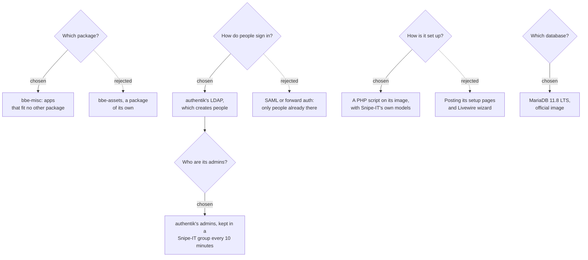

# 0009: Snipe-IT, in a package for apps that fit no other

**Status:** proposed, 2026-10-23

## Context

The household wants to keep track of its things: what there is, who has it, and its receipts and warranties. No package fits that, and more apps like it will come, each too small for a package of its own.

Everyone in the household signs in, with the same account as everywhere else ([0002](0002-single-sign-on.md)):
- **`users`** see what's checked out to them.
- **`admins`** manage everything.

The app is also reachable from outside, through the Cloudflare tunnel ([0008](0008-public-access-through-cloudflare.md)).

Things that shaped what follows, read in Snipe-IT 8.8.3's source:
- **It runs from an official image** (`snipe/snipe-it`), with Apache, PHP and a scheduler. It migrates its database every time it starts, and carries on without it if the database doesn't answer.
- **It sends every page to its setup page** until there are settings and someone in its database.
- **Its settings have no API.** LDAP is set up through a multi-step Livewire wizard.
- **LDAP sign-in creates people.** Snipe-IT finds the person with its own account, binds as them, and creates them on their first sign-in.
- **SAML and OpenID Connect only sign in people already in its database.**
  - SAML is for the browser, and someone would have to create each person in Snipe-IT first.
  - OpenID Connect only checks API tokens.
- **Its "remote user" sign-in only reads server variables,** and refuses headers. Traefik's forward auth can't reach it without changing Apache in the image.
- **Snipe-IT pins every link to `APP_URL`,** and refuses other names, unless it's told not to.

## Decision tree

## Decisions

### 1. A package for apps that fit no other, starting with Snipe-IT

`bbe-misc` holds apps that don't belong with the media, the books or the music. Snipe-IT is its first.

When a second app joins, each app gets its own switch (`bbe.misc.<app>.enabled`), so `bbe-misc` doesn't install apps nobody asked for.

Rejected: **a package named after Snipe-IT, such as `bbe-assets`.** Every small app would be one more package to choose in `bbe install`.

### 2. Snipe-IT runs from its official image

[Snipe-IT](https://snipeitapp.com) 8.8.3, from `snipe/snipe-it:v8.8.3`.

**How it runs:**
- **Its start runs as root,** to create its folders on its volume and give them to its own user (10000). Apache then runs as that user. The `baseline` pod security level allows that.
- **Its volume** holds uploaded files and pictures, and its OAuth keys. It's 2Gi of Longhorn, mounted at `/var/lib/snipeit`. One pod at a time (`Recreate`).
- **Its key** (`APP_KEY`) is generated into `bbe-misc-snipeit` on the first install, and never changes. Snipe-IT encrypts the LDAP password and its sessions with it.
- **`/health` is what the probes check,** as it answers before Snipe-IT is set up.

**Its settings:**
- **Its own names:** `APP_URL` is `https://snipeit.<domain>`. `APP_ALLOW_INSECURE_HOSTS` lets it answer at its public name too. Traefik only passes on the names it has routes for.
- **Traefik:** it's trusted as the proxy from the private address ranges, like authentik trusts it.
- **The LDAP wizard:** `TEST_ALLOW_PRIVATE_IPS` lets it test authentik's LDAP, which is in the cluster.
- **Mail:** there's no mail server yet, so mail is written to Snipe-IT's log (`MAIL_MAILER=log`).

Snipe-IT is served at `snipeit.<domain>`, and listed on the dashboard ([0003](0003-dashboard.md)) in a new group, `Keep`, between `Listen` and `Manage`.

### 3. Its database is MariaDB, from the official image

A StatefulSet with `mariadb:11.8.9`, a long-term support release, on a 2Gi volume of the default storage class, like bbe-auth's PostgreSQL ([0002](0002-single-sign-on.md), decision 4).
- **User:** it runs as the image's `mysql` user (999), with a read-only root filesystem.
- **Probes:** the image's own `healthcheck.sh`, with the account its first start creates.
- **Upgrades:** `MARIADB_AUTO_UPGRADE` upgrades its system tables when a newer MariaDB starts on older data.
- **Waiting for it:** Snipe-IT waits for it with an init container, as it migrates on start and carries on without the database if it doesn't answer.

Snipe-IT's own Docker setup uses MariaDB. Its SQLite support is only for its tests.

### 4. People sign in with authentik's LDAP

Snipe-IT signs people in against bbe-auth's LDAP outpost, as Jellyfin and the book library do:
- **Snipe-IT's own account:** it searches with `snipeit-ldap`, which bbe-auth's blueprint creates with the others. Its password is generated into `bbe-auth-authentik` and copied into `bbe-misc-auth`.
- **Only `users` and `admins`:** its search filter finds people in either group, then it binds as the person found.
- **People are created on their first sign-in.** authentik's `displayName` goes into Snipe-IT's first name, its only required name, and `mail` into their email.
- **Passwords aren't copied into Snipe-IT** (`ldap_pw_sync` off). Someone authentik stops letting in can't sign in with the password they had.
- **"Forgot your password" leads to authentik's user settings,** as authentik's LDAP can't change passwords.

Rejected:
- **SAML**, which authentik can serve. Snipe-IT only signs in people already in its database, so someone would have to create each person in Snipe-IT first.
- **Forward auth with Snipe-IT's remote user sign-in.** It only reads server variables, so its Apache would need changing, and it also only signs in people already there.

### 5. authentik's admins are Snipe-IT's admins

- **Snipe-IT's `admins` group** can do everything (`superuser`). The setup keeps exactly authentik's `admins` in it, among the people Snipe-IT created from LDAP.
- **A CronJob** runs that part of the setup every 10 minutes (`bbe.setup.peopleSchedule`), as Snipe-IT creates people on their first sign-in. Someone leaving `admins` in authentik leaves Snipe-IT's group the same way.
- **`users` get no rights.** They see what's checked out to them, and ask for what's requestable.
- **Snipe-IT's own admin** (`bbe.misc.snipeit.admin.username`, `snipeit-admin`) isn't in LDAP. It signs in with its own password, generated into `bbe-misc-admin`, when authentik can't help.

People added in Snipe-IT itself, and its own admin, are left alone.

### 6. The setup runs Snipe-IT's own code

The setup Job runs a PHP script on Snipe-IT's image, as Snipe-IT's own user. It boots Snipe-IT and uses its models:
1. **Waits** until every migration in the image has run, as Snipe-IT migrates on start.
2. **Creates Snipe-IT's own admin**, and keeps its password the one in `bbe-misc-admin`.
3. **Saves the first settings** its setup page would, so nobody goes through it.
4. **Sets up LDAP sign-in** (decision 4). The LDAP password is encrypted with Snipe-IT's key, as its wizard does.
5. **Keeps the admins in line** (decision 5).

It reads before it writes, so a second run changes nothing.

Rejected:
- **Posting Snipe-IT's setup page and LDAP wizard,** as the book library's setup posts CWA's forms ([0004](0004-book-library.md), decision 6). The LDAP wizard is Livewire, whose requests carry its component state rather than a form.
- **Writing the settings with SQL.** The LDAP password would have to be encrypted the way Laravel does, and the setup would follow Snipe-IT's tables rather than its models.

### 7. Only Traefik reaches Snipe-IT, and only Snipe-IT its database

Following [0007](0007-network-policies.md):

| Package | Pods | Who may reach them |
|---|---|---|
| bbe-misc | all | its own pods |
| | Snipe-IT | also Traefik |
| bbe-auth | the LDAP outpost | also bbe-misc |

It's reached from outside through the tunnel, behind Cloudflare Access ([0008](0008-public-access-through-cloudflare.md), decision 2). It sits behind Access like the book library: Snipe-IT has no apps that need to get past it.

## Consequences

- **A new admin can do everything in Snipe-IT within 10 minutes** of being added to `admins`, or of their first sign-in.
- **People removed from authentik stay in Snipe-IT**, with what's checked out to them, but can't sign in.
- **Snipe-IT's key never changes.** Losing `bbe-misc-snipeit` makes the LDAP password unreadable, and LDAP sign-in stops until the setup runs again.
- **Snipe-IT sends no email** until a mail server is set up.
- **Uninstalling `bbe-misc`** deletes its namespace, with the inventory, its database and its files.
- **bbe-auth changes with this:**
  - the `snipeit-ldap` account;
  - its password in `bbe-auth-authentik`;
  - bbe-misc in the LDAP outpost's NetworkPolicy.
- **What's verified, and what isn't:**
  - **Against Snipe-IT 8.8.3's own code, on SQLite,** with a stand-in for PHP's LDAP extension:
    - The setup ran: it created the admin, the first settings, the LDAP settings and the `admins` group, and a second run changed nothing.
    - It waited for a missing database and for an unfinished migration, and gave up after its timeout.
    - **Sign-ins:** Snipe-IT's own LDAP sign-in, with those settings, found and created a person in `admins` and one in `users`, with their names and emails. It refused someone in neither group, and a wrong password. It didn't copy passwords.
    - **Admins:** the people run kept exactly authentik's `admins` in Snipe-IT's `admins` group as they moved between groups.
  - **Unit tests** cover the chart, and bbe-auth's and bbe-networking's changes.
  - **Not run yet:**
    - Snipe-IT's image, MariaDB, and the setup on Snipe-IT's image;
    - an LDAP sign-in against authentik itself;
    - the chart on a cluster.

    There was no container runtime, and no test cluster.
