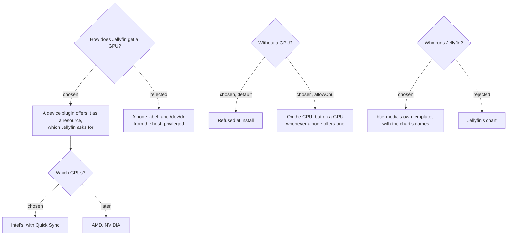

# 0011: Jellyfin transcodes on a GPU, and only runs where there is one

**Status:** proposed, 2026-10-24

## Context

Jellyfin transcodes whatever a device can't play as it is, such as HEVC to a browser, or 4K to a phone on mobile data. On the CPU, a single 4K transcode can take a small machine's every core. A GPU's video engine does the same with almost no CPU. Jellyfin should run on a node that can do that, and only there, unless told otherwise.

Things that shaped what follows, checked on 2026-10-24:
- **Talos has no GPU driver by default.** `/dev/dri` only exists with its `siderolabs/i915` extension (Intel) or `siderolabs/amdgpu` (AMD). NVIDIA needs non-free kernel modules and its container toolkit. bbe's amd64 node image had neither.
- **The current control plane, `tops-star-brand`, has an Intel Kaby Lake HD Graphics 620** (7th generation). Its Quick Sync decodes and encodes H.264 and HEVC, 10-bit included, and decodes VP9. It has no AV1. Low-power encoding isn't needed, and needs GuC firmware loading Talos doesn't turn on.
- **The linuxserver image** has jellyfin-ffmpeg with Intel's and AMD's VA-API and QSV drivers, and gives Jellyfin's user the `/dev/dri` devices it's handed. OpenCL tone mapping needs Intel's OpenCL runtime, which linuxserver offers as a mod.
- **Jellyfin's chart writes its Deployment's resources from its values,** which bbe-media can't change from what the cluster has.

## Decision tree



## Decisions

### 1. Talos gets Intel's GPU driver on every amd64 node

bbe's amd64 node image adds `siderolabs/i915` to its extensions (bbe-quest, schematic `bbdb2fb8…`). On a machine without an Intel GPU, the driver doesn't load. Every amd64 node has it, so a GPU added later just works.

A node set up before this keeps its old image until it's upgraded to one with the extension:

```bash
talosctl -n <node> upgrade --image factory.talos.dev/metal-installer/bbdb2fb8f886104868f647ffbe8eab12b403bc00db5d39d0ccd73751b4fa472c:<its Talos version>
```

Rejected: **a Talos prerequisite of bbe-gpu**, which bbe would add to existing nodes itself, as it does for Longhorn's extensions. bbe checks a prerequisite on every node, so it would ask a Raspberry Pi for Intel's driver too.

### 2. bbe-gpu offers the GPUs, with Intel's device plugin

`bbe-gpu`, a new package, runs Intel's GPU device plugin 0.37.1 on every amd64 node, from Intel's own manifest.
- **The resource:** the plugin offers `gpu.intel.com/i915` on nodes with an Intel GPU and the driver.
- **Getting it:** a pod asking for one is only scheduled on such a node, and gets its `/dev/dri` devices, without being privileged itself.
- **Sharing:** each GPU can be shared by 2 pods (`bbe.gpu.intel.sharedDevNum`), so another app can use it too.
- **Its own access:** the plugin reads `/dev/dri` and registers with the kubelet through host folders. Its namespace is therefore `privileged`, though its container drops every capability.

`bbe-media` needs `bbe-gpu` (`bbe/prerequisites`), so it's installed first, and the GPU is offered by the time Jellyfin is installed.

Rejected:
- **Intel's operator.** It needs cert-manager for its webhooks, which the API server calls from the node's network ([0007](0007-network-policies.md), decision 1), for one DaemonSet.
- **Node Feature Discovery.** It would label nodes by their hardware, but the plugin already only offers GPUs that exist.
- **A label and `/dev/dri` from the host,** with Jellyfin privileged. A wrong label would go unnoticed: Jellyfin would quietly transcode on the CPU, with far more access to the node than it needs.

### 3. Jellyfin asks for a GPU, unless the CPU is allowed

`bbe.media.jellyfin.transcoding`, which bbe records in `bbe.yaml` with its defaults:

| Setting | Default | |
|---|---|---|
| `allowCpu` | `false` | Whether Jellyfin may run without a GPU |
| `gpu` | `gpu.intel.com/i915` | The resource it asks for |
| `acceleration` | `qsv` | Quick Sync, or `vaapi` |
| `decodingCodecs` | `h264, hevc, mpeg2video, vc1, vp8, vp9` | What Kaby Lake and newer decode. `av1` from the 11th generation |
| `tenBitDecoding` | `true` | 10-bit HEVC and VP9 |
| `hevcEncoding` | `true` | HEVC as well as H.264 |
| `av1Encoding` | `false` | Needs Arc, or the 14th generation |
| `tonemapping` | `false` | HDR to SDR with OpenCL, through linuxserver's mod |

**When bbe-media is installed or upgraded**, it looks at what the nodes offer:
- **Without `allowCpu`,** Jellyfin always asks for one `gpu.intel.com/i915`. If no node offers one, the install is refused, saying how to fix it or allow the CPU. Otherwise Jellyfin would wait in Pending.
- **With `allowCpu`,** Jellyfin asks for a GPU if any node offers one, and otherwise runs anywhere on the CPU. It moves to a GPU on the next upgrade after one appears.

**Jellyfin's settings follow:** bbe-media's setup sets them through Jellyfin's API, as it does its transcoding folder ([0001](0001-media-auto-setup.md)).
- **On a GPU:** the acceleration, the render node `/dev/dri/renderD128`, the codecs, hardware encoding, and no low-power encoders.
- **On the CPU:** no acceleration.

Jellyfin's other encoding settings are left as they are.

Jellyfin restarts with `Recreate`, as its volumes are on one node, and a new pod would otherwise wait for the old one's share of the GPU.

### 4. bbe-media runs Jellyfin itself

`bbe-media` no longer uses Jellyfin's chart: `templates/jellyfin.yaml` has Jellyfin's Deployment, its config and cache volumes, and its Service.
- **Same names:** `bbe-media-jellyfin`, `bbe-media-jellyfin-config`, `bbe-media-jellyfin-cache`.
- **Same selector labels:** `app.kubernetes.io/name: jellyfin` and `app.kubernetes.io/instance: bbe-media`.

So a cluster set up with the chart keeps its volumes, and its Deployment is updated in place. The chart's ServiceAccount is removed, as Jellyfin doesn't use the Kubernetes API.

Rejected: **keeping the chart.** A parent chart can only give a subchart values from its values files, never what it looked up, so the GPU couldn't depend on the cluster.

## Consequences

- **Jellyfin doesn't install on a cluster without an Intel GPU** until `allowCpu` is set, which the error says.
- **With `allowCpu`, a GPU that appears later is only used from the next `bbe upgrade`.**
- **A node set up before this needs upgrading** to bbe's image to offer its GPU (decision 1).
- **On a node with two GPUs,** the device plugin may hand Jellyfin the second, while Jellyfin's settings name the first render node.
- **AMD and NVIDIA aren't offered yet.** AMD needs Talos' `amdgpu` and AMD's device plugin, and `gpu: amd.com/gpu` with `vaapi`. NVIDIA needs Talos' non-free modules, the container toolkit and a runtime class.
- **Tone mapping, once turned on,** has Jellyfin download linuxserver's OpenCL mod every time it starts.
- **Not run on a cluster yet:**
  - the extension on a node;
  - the plugin offering the HD 620;
  - Jellyfin transcoding on it.

  Verified:
  - the charts render and their tests pass, the GPU choice included, against nodes with and without a GPU;
  - the setup's encoding step ran against a stand-in for Jellyfin's API, and a second run changed nothing;
  - the new image is built by the Image Factory.
