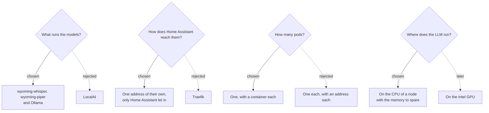

# 0012: Home Assistant's voice assistant hears, thinks and speaks on the cluster's CPUs

**Status:** proposed, 2026-11-04

## Context

Home Assistant runs on a machine of its own, outside the cluster. Its voice assistant turns what's said into text, works out what to do with it, and answers out loud. Each step can run elsewhere: speech-to-text and text-to-speech over the Wyoming protocol, and the conversation agent as an LLM, through its Ollama integration. bbe-ai runs them on the cluster, so nothing said leaves the house.

Things that shaped what follows, checked on 2026-11-04:
- **The nodes are small.** Two have 7 GB of memory, already half to three-quarters requested. One has 16 GB, a tenth requested. Their GPUs are Intel's integrated ones, which Jellyfin shares ([0011](0011-gpu-transcoding.md)).
- **An LLM on a CPU is slow to read, not to write.** A 1.5–4B model at 4 bits writes 5–15 tokens a second. But Home Assistant's prompt lists the entities exposed to it, often thousands of tokens, which takes tens of seconds to read the first time.
- **Home Assistant can skip the LLM.** With "Prefer handling commands locally", its own intents handle "turn off the kitchen light" in a moment, and only what they don't understand goes to the LLM.
- **Wyoming is TCP, not HTTP.** Wyoming has no sign-in, and neither does Ollama's API.
- **wyoming-whisper 3.8.1** picks its backend per language. English gets NVIDIA's Parakeet TDT 0.6B v2, int8, through sherpa-onnx, the default of Home Assistant's add-on too. faster-whisper's `base.en` is lighter, and is the one that can be biased toward Home Assistant's names.
- **wyoming-piper 2.5.2** speaks with Piper's voices, ~60–100 MB each, quickly on a CPU.
- **Home Assistant's Ollama integration** defaults to `qwen3:4b-instruct`, thinking off, an 8192-token context and keeping the model loaded. It sends that context size with every request.
- **MetalLB** only shares an address between Services with `externalTrafficPolicy: Local` if they select the same pods.

## Decision tree

## Decisions

### 1. wyoming-whisper, wyoming-piper and Ollama run the models

Home Assistant speaks to each through an integration of its own, with nothing to install on its side.
- **Speech-to-text:** wyoming-whisper with `--language en` and its own choice of model, Parakeet for English. `bbe.ai.speechToText.library` and `model` switch to faster-whisper's `base.en`, which needs less memory.
- **Text-to-speech:** wyoming-piper, with `en_US-lessac-medium`.
- **The LLM:** Ollama, with `qwen3:1.7b`, which fits an 8 GB node. `qwen3:4b-instruct` is Home Assistant's default, and needs ~4 GB. An init container downloads the model before Ollama serves it, and keeps one already downloaded, so a restart needs no internet. Ollama keeps it loaded, serves one conversation at a time, and has its cloud features off.
- **Memory:** Ollama's request and limit are the same, sized for the model and an 8192-token context, with its cache in `q8_0`. The pod is only scheduled on a node with that much to spare, and can't take memory from the node's other apps.

Every server downloads into its own folder on one Longhorn volume, and runs as a user with no capabilities, so the namespace is `restricted`.

Rejected: **LocalAI.** It runs all three, but in images of several GB, and Home Assistant can't reach its speech models over Wyoming.

### 2. Home Assistant reaches them at an address of their own, and only Home Assistant does

A LoadBalancer Service, at an address of MetalLB's that only it gets (`bbe.ai.loadBalancerIP`), serves speech-to-text at 10300, text-to-speech at 10200 and Ollama at 11434, the ports Home Assistant suggests. It keeps the client's address (`externalTrafficPolicy: Local`), so a NetworkPolicy lets in only Home Assistant's (`bbe.ai.homeAssistantIP`), and any in `bbe.ai.allowFrom`. bbe asks for both addresses when it installs bbe-ai, as the chart's schema requires them.

Rejected: **Traefik.** Wyoming isn't HTTP. Traefik would need TCP entrypoints of its own in bbe-networking, and Home Assistant would have to trust the cluster's certificate authority to reach Ollama over HTTPS.

### 3. The three run in one pod

MetalLB only shares an address keeping the client's between Services selecting the same pods. One pod therefore gives Home Assistant one address, and the NetworkPolicy Home Assistant's own.
- **They don't compete:** for each thing said, the three run one after the other.
- **They restart together:** changing the model restarts the speech too, which loads again from the volume in seconds.
- **They run on one node:** the speech's ~1 GB goes where the LLM fits.

Rejected: **a pod each.** That needs an address each, three to keep free, or traffic that loses Home Assistant's address, which lets anything on the LAN in.

### 4. The LLM runs on the CPU

The pod is offered no GPU. An HD 620 shares the CPU's memory, which is what limits an LLM, so it would gain little, and Jellyfin uses it. Ollama's Vulkan support could try it later, through bbe-gpu.

## Consequences

- **Answers from the LLM take seconds**, mostly reading the prompt. Exposing fewer entities to the assistant keeps that short. Commands Home Assistant understands itself don't wait for it.
- **The first question after a restart** waits for the model to load.
- **On a cluster without a node with Ollama's memory to spare,** the pod waits in Pending, the speech with it, until the model is smaller, the memory freed, or Ollama is turned off.
- **Changing the model** downloads the new one next to the old, which stays on the volume.
- **The root filesystems aren't read-only.** The images write caches outside the volume, which hasn't been checked.
- **Not run on a cluster yet:**
  - the servers running as a user, on a fresh volume;
  - the speech's memory and how long it takes on these CPUs, which the requests are a guess at;
  - Home Assistant reaching them through MetalLB and the NetworkPolicy;
  - how long the LLM takes to answer.

  Verified:
  - the chart renders, and its tests pass, with and without Ollama;
  - installing is refused without the two addresses.
