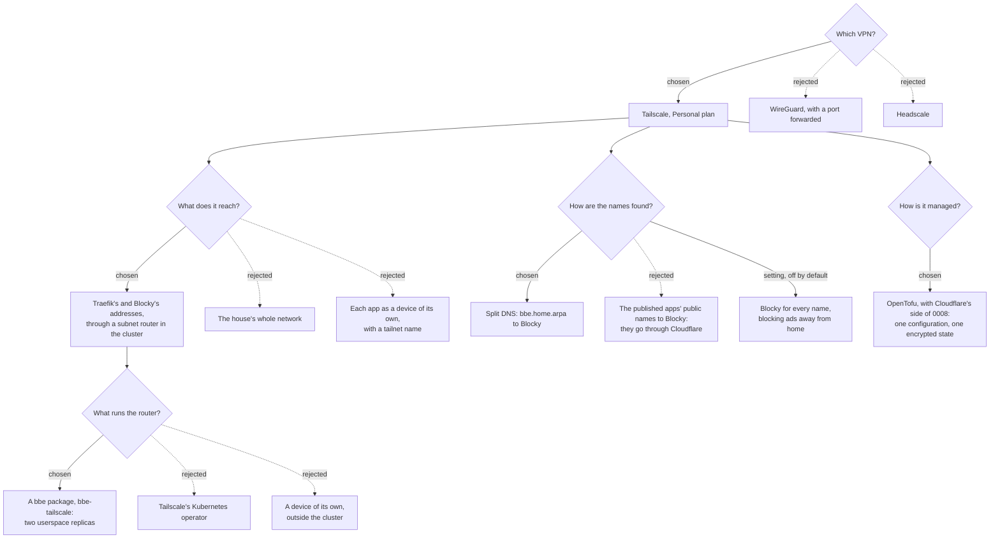

# 0013: Reaching every app from outside through Tailscale

**Status:** proposed, 2026-11-10

## Context

[0008](0008-public-access-through-cloudflare.md) publishes three apps through Cloudflare, for devices that can't run a VPN: Jellyfin, Calibre-Web-Automated and Music Assistant. Those three stay out of the VPN: away from home they're only reached through Cloudflare. Every other app, from Seerr to the Servarr apps and Grafana, is only for the house's network, and "the VPN" from outside, which nothing had chosen yet.

What that access must have:
- **No open ports on the router**, as for 0008.
- **The same names as at home:** `<app>.bbe.home.arpa`, with bbe's CA and authentik's one sign-in, whose cookie is for `.bbe.home.arpa` ([0002](0002-single-sign-on.md), decision 6). Bookmarks work wherever you are.
- **Nothing changes at home:** on the house's network, every app works without a VPN, as now.
- **Only the apps:** the VPN reaches Traefik and Blocky, not the rest of the house's network, the nodes, or the Talos and Kubernetes APIs.
- **Managed as code,** with OpenTofu, next to Cloudflare's side of 0008.
- **Free:** no paid plans or services for now.

Things that shaped what follows, checked on 2026-11-10:
- **Tailscale connects outbound,** and through NAT. When two devices can't reach each other directly, it relays through its DERP servers. No port is opened on the router.
- **The Personal plan is free** for non-commercial use. Since April 2026 it has 6 users and unlimited devices of theirs, by third-party write-ups of Tailscale's pricing. Tailscale's own page wasn't reachable to confirm it.
- **A subnet router** advertises routes to addresses that aren't on the tailnet. Its routes are approved in the admin console, or by `autoApprovers` in the tailnet's policy file.
- **Subnet routing works in userspace (netstack) mode,** without root or `NET_ADMIN`.
  - **How:** it ends each TCP and UDP connection from a device, and opens a new one to the address from the router.
  - **Limits:** TCP and UDP only.
  - **When it's enough:** Tailscale recommends the kernel's mode for heavily used routers, and says userspace suits a few users or little bandwidth.
- **Tailscale's container image** (containerboot) is configured with variables:
  - `TS_USERSPACE` picks the mode;
  - `TS_ROUTES` the routes to advertise;
  - `TS_AUTHKEY` the key to join with;
  - `TS_KUBE_SECRET` the Kubernetes Secret it keeps its state in.
- **High availability:** several routers advertising exactly the same routes. One is the primary, and another takes over about 15 seconds after it goes offline.
- **Split DNS** sends the names under a domain to the nameservers given for it. Every other name is resolved as the device does without Tailscale.
- **Tailscale's provider** for Terraform and OpenTofu was at 0.29.2 (May 2026). Its resources include:
  - `tailscale_acl`, the whole policy file;
  - `tailscale_dns_configuration`, the whole DNS configuration, and not to be used with the resources that each set part of it, such as `tailscale_dns_split_nameservers`;
  - `tailscale_tailnet_key`, auth keys.
- **Linux devices** only use advertised routes with `--accept-routes`. Other systems use them by default.
- **Blocky answers `bbe.home.arpa`** and everything under it with Traefik's IP. Both have an address of MetalLB's on the house's network ([0002](0002-single-sign-on.md), decision 6; [0010](0010-dns-blocking.md)).

## Decision tree

## Decisions

### 1. Tailscale, on its free Personal plan

The household's phones and computers run Tailscale and join one tailnet. Each person signs in to it with an account of their own, at a provider Tailscale supports, and the cluster's owner invites them.

Rejected:
- **WireGuard on the router or in the cluster.** It needs a port forwarded to it, which 0008 rules out. Adding a device means handing out its keys by hand.
- **Headscale.** It replaces Tailscale's coordination server, which then has to be reachable from the internet: a port forwarded, or a server outside the house to run and keep up to date.
- **Cloudflare's WARP, to a private network over the tunnel.** Cloudflare would see every app's traffic, the streams included, which its terms forbid (0008, Context).

Left for later: **signing in to Tailscale with authentik.** People would be managed in one place, but Tailscale would need to reach authentik through 0008's tunnel. If the house were down, nobody could sign in to the VPN to fix it.

### 2. A subnet router in the cluster reaches Traefik and Blocky, and nothing else

A new package, `bbe-tailscale`, runs Tailscale as a subnet router. It's named after Tailscale, as bbe-media's and bbe-music's `vpn` already means the VPN their downloads go through.

**It advertises two addresses:**
- the ingress's IP (`global.bbe.ingress.loadBalancerIP`), as a `/32`;
- Blocky's, as a `/32` each.

bbe-tailscale's schema requires both, so bbe asks for them on install, as for bbe-ai's addresses ([0012](0012-voice-assistant.md), decision 2). A device on Tailscale reaches every app through Traefik, as at home, and nothing else in the house.

**How it runs:**
- **Pods:** two replicas of a pinned `tailscale/tailscale` image, in a StatefulSet. Both advertise the same routes, so one takes over within about 15 seconds if the other's node goes down.
- **Userspace mode** (`TS_USERSPACE=true`): no root and no capabilities, so the namespace is `restricted`. Traffic is a household's, so userspace's speed is enough.
- **State:** each replica keeps its state in a Secret of its own (`TS_KUBE_SECRET`, named after the pod), which the chart creates. Its Role can only read and write those two.
- **Joining:** with an auth key from a Secret, which OpenTofu creates (decision 5). It's reusable, preauthorised and tagged `tag:bbe`. A tagged device belongs to the tailnet, not to a person, and its key doesn't expire.
- **NetworkPolicies:** following [0007](0007-network-policies.md), nothing may reach its pods but `bbe-observability`, for its metrics. It only connects out, to Tailscale and the two addresses.

**It reaches Traefik like a device at home,** on Traefik's own entrypoint. It's not let in to `public`, 0008's entrypoint for cloudflared, which only bbe-tunnel's pods reach (0008, decision 8).

Rejected:
- **Advertising the house's whole network.** Every device in the house would be reachable from every device on the tailnet, and the nodes' Talos and Kubernetes APIs with them. Their firewall only lets in the networks given to `bbe setup`, and the router would come from one of them.
- **Each app as a device of its own,** with a name like `jellyfin.<tailnet>.ts.net`. Every app would have a different name outside, a certificate of Tailscale's, and its own authentik cookie domain.
- **Tailscale's Kubernetes operator,** with a `Connector`. It runs the same router, but with an operator, its CRDs and an OAuth client allowed to create devices, for one router.
- **A device of its own outside the cluster,** such as the router or a Raspberry Pi. It works without the cluster, but it's set up by hand and not in `bbe.yaml`.

### 3. Tailscale's DNS sends the house's names to Blocky

Split DNS, for every device on the tailnet:

| Names | Asked of |
|---|---|
| `bbe.home.arpa` and everything under it | Blocky's address |
| Everything else, the public names 0008 publishes included | The device's own DNS, as without Tailscale |

**The apps 0008 publishes don't go through Tailscale.** Away from home, Jellyfin, Calibre-Web-Automated and Music Assistant are reached by their public names, through Cloudflare, Tailscale on or not (0008, decision 2). Their `bbe.home.arpa` names aren't meant to be used over Tailscale either, but nothing enforces that (Consequences).

If the router is down, only the house's names stop resolving. Everything else on the device works as before.

**Blocking ads away from home** is a setting, `bbe.tailscale.dns.blockEverywhere`, off by default. On, Blocky is the tailnet's nameserver for every name, overriding the device's own DNS, so a phone gets the house's blocking ([0010](0010-dns-blocking.md)) anywhere. It's off because, while the router is down, nothing would resolve on a device with Tailscale on.

MagicDNS stays on, so devices on the tailnet still find each other by name.

### 4. The tailnet's policy only lets the household reach the two addresses

bbe writes the tailnet's whole policy file (`tailscale_acl`), from `bbe.yaml`:
- **`tag:bbe`** is owned by the tailnet's admins (`autogroup:admin`). Only they can create keys for it.
- **`autoApprovers`** approves the two routes for `tag:bbe`, so nobody approves them by hand, and no other device can advertise them.
- **Members of the tailnet** (`autogroup:member`) may reach:
  - the ingress's IP on 80 and 443, TCP;
  - Blocky's on 53, TCP and UDP.

  Nothing else on those addresses, and nothing else in the house.
- **Anything more the household wants**, such as reaching a computer of their own across the tailnet, goes in `bbe.tailscale.policy.grants`, which bbe adds to the file.

**bbe owns the policy file.** What's added in Tailscale's admin console is replaced on the next apply, as for 0008's blocked addresses (0008, decision 7). Tailscale's default policy, which lets every device reach every other, is replaced too.

Who's in the tailnet is managed in Tailscale's admin console: inviting someone, or removing them and their devices. Every member also signs in to each app as at home, through authentik.

### 5. OpenTofu configures Tailscale, with Cloudflare's side of 0008

Tailscale's side is an OpenTofu module in this repository, `tofu/tailscale`, released with the charts, using Tailscale's provider (0.29.2, or the newest when it's built):

| Resource | What it holds |
|---|---|
| `tailscale_acl` | The policy file (decision 4) |
| `tailscale_dns_configuration` | Split DNS, MagicDNS and, with `blockEverywhere`, Blocky as the nameserver for every name (decision 3). It's the whole DNS configuration, so it's the only DNS resource the module uses |
| `tailscale_tailnet_key` | The router's auth key: reusable, preauthorised, tagged `tag:bbe` |

It's applied with `tofu/cloudflare`, from the same configuration in `~/.bbe/tofu/`, the same encrypted state and passphrase, and the same choice of who runs it (0008, decisions 9 and 10). bbe reads the auth key from OpenTofu's output into bbe-tailscale's Secret.

**Tailscale's credentials** are an OAuth client, limited to the policy file, DNS and auth keys for `tag:bbe`. bbe reads them from `TAILSCALE_OAUTH_CLIENT_ID` and `TAILSCALE_OAUTH_CLIENT_SECRET`, or asks for them each time, and never saves them.

Rejected: **an API key.** It expires within 90 days, and can do everything its owner can.

### 6. At home, nothing changes

Devices on the house's network ask Blocky, as the router's DHCP tells them, and reach Traefik directly. They don't need Tailscale.

A device that keeps Tailscale on at home still works. It reaches Traefik and Blocky through the router in the cluster, which takes a little longer than reaching them directly.

## Consequences

- **The household's phones and computers need Tailscale,** and an account each. Seven people or more need a paid plan, if the free plan's 6 users holds. Linux computers also need `tailscale set --accept-routes`.
- **Devices that can't run Tailscale,** such as TVs and e-readers, only reach what 0008 publishes from outside.
- **Tailscale's coordination servers are needed** to join, and to learn of new devices or routes. Devices already connected keep working for a while if they're down.
- **Apps see the router's pod as the client,** not the device on the tailnet, as the router opens its own connections. authentik still records who signed in. There's no record of which device reached which app through Tailscale on the free plan.
- **The tailnet's policy file and DNS settings belong to bbe.** Changes made in Tailscale's admin console are undone by the next apply.
- **The auth key expires,** at most 90 days after OpenTofu creates it. The router's devices keep their state and don't need it again. A replica that loses its state can't join until the key is created again, by the next apply.
- **The published apps' `bbe.home.arpa` names still answer through Tailscale.** The router reaches Traefik, which serves every app on one address, and Tailscale's policy can only allow or refuse addresses and ports, not names. Keeping Jellyfin, Calibre-Web and Music Assistant off Tailscale relies on devices using their public names away from home. Enforcing it would take a rule on their routers in Traefik refusing the router's pods, which isn't decided here.
- **The nodes, and the Talos and Kubernetes APIs, aren't reachable through Tailscale.** Managing the cluster from outside isn't part of this.
- **Userspace mode is slower than the kernel's.** Nothing is meant to stream through it, as the apps that stream are kept out of Tailscale. If it's still too slow, the router can move to the kernel's mode, which needs `NET_ADMIN` and a `privileged` namespace.
- **`bbe-observability` gets a PodMonitor for the router's metrics**, as for the other packages ([0006](0006-observability.md), decision 3).
- **Not built or verified.**
  - **Checked on 2026-11-10,** against Tailscale's documentation and the provider's changelog: userspace subnet routing, containerboot's variables, high availability, and the provider's resources.
  - **From third parties only:** the Personal plan's 6 users.
  - **Not checked:**
    - whether split DNS takes a single host, such as `jellyfin.<public domain>`, as its domain;
    - the OAuth client's scopes for the policy file, DNS and tagged keys;
    - `tailscale_dns_configuration`'s fields;
    - the metrics containerboot serves;
    - how much userspace routing slows the apps down.
